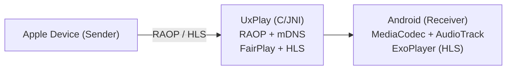

# Buzin Cast

Receptor gratuito, sem anúncios e sem limite de tempo para Fire TV com Fire OS.

A edição principal 0.6.0 tem mínimo Fire OS 6. A edição de compatibilidade (`-PbuzinLegacy=true`) compartilha o código e seleciona as versões Android mais recentes que ainda aceitam Fire OS 5. Ambas usam as ferramentas estáveis/LTS atuais. Compilação e emuladores não substituem validação nos aparelhos Amazon. Consulte [versões e compatibilidade](docs/DEPENDENCIES.md) e [testes e cobertura](docs/TESTING.md).

Repositório do Buzin Cast: https://github.com/HenriqueBuzin/buzin-cast

Criação e manutenção do Buzin Cast: **Henrique Buzin**. Derivado de android-airplay-server, de jqssun e contribuidores. Código sob [GNU GPL v3](LICENSE), com créditos originais preservados. Veja [AUTHORS.md](AUTHORS.md).

A logo aprovada na lista de aplicativos é permanente: B à esquerda, Buzin acima e CAST abaixo à direita, sem bordas externas. Preservar a mesma arte nas duas edições e nas próximas atualizações; só redesenhar mediante pedido explícito de Henrique. O CI verifica os arquivos e as referências do launcher com `tools/verify_brand.py`. Conferir também o cache do Fire OS após atualizar um aparelho.

**Protótipo em desenvolvimento; recursos e compatibilidade ainda precisam de testes no aparelho.**

Versão 0.6.0: núcleo de sessões com gerações, adaptadores de recepção, logs assíncronos, perfis por capacidades do decodificador e navegação TV reutilizável. Testes de domínio e integração automatizados: [como executar e limites](docs/TESTING.md).

Versão 0.2.0: gravação manual do espelhamento AirPlay em MKV com áudio, retransmissão criptografada entre dois Buzin Cast, visualizador/apresentação de fotos DLNA e atalho para o Miracast nativo quando disponível. Google Cast/Chromecast continua pendente. Esses recursos são experimentais; não equivalem à compatibilidade completa do AirScreen.

Versão 0.3.0: nova identidade visual e tela inicial para TV, navegação lateral e ajuste imediato de bordas para o espelhamento. Nome padrão Buzin Cast, personalizável nas Configurações.

Consulte [BUZIN_CAST.md](BUZIN_CAST.md) para escopo, estado real das funções, compilação, instalação e publicação. Consulte [THIRD_PARTY_NOTICES.md](THIRD_PARTY_NOTICES.md) para os créditos.

O conteúdo a seguir é o README original da base utilizada, preservado para referência. Links, badges e anúncios de versões abaixo pertencem ao projeto original, não são versões do Buzin Cast.

---

# AirPlay Receiver for Android — documentação original

[](https://github.com/jqssun/android-airplay-server)
[](https://github.com/jqssun/android-airplay-server/releases)
[](https://github.com/jqssun/android-airplay-server/blob/main/LICENSE)
[](https://github.com/jqssun/android-airplay-server/actions/workflows/apk.yml)
[](https://github.com/jqssun/android-airplay-server/releases)

A fully featured free and open-source implementation of AirPlay for Android that turns your device into an AirPlay-compatible display and speaker, based on [UxPlay](https://github.com/FDH2/UxPlay). It is the first open-source AirPlay 2 receiver for Android and Android TV, and works with iOS/iPadOS, macOS devices as well as other sender implementations.

[](https://play.google.com/store/apps/details?id=io.github.jqssun.airplay)
[](https://f-droid.org/packages/io.github.jqssun.airplay)
[](https://github.com/jqssun/android-airplay-server/releases/latest)

<video loop src='https://github.com/user-attachments/assets/79ed7c0c-0102-43cc-8816-4f00ce6a4199' alt="demo" width="200" style="display: block; margin: auto;"></video>

## Compatibility

- Android 7.0+, including Android TV
- AirPlay devices on the same subnet, including iOS/iPadOS, macOS devices, or other sender implementations

## Features

- Screen mirroring with H.264 and H.265 (HEVC) video decoding
- Audio streaming with AAC-ELD, AAC-LC and ALAC audio decoding
- Video playback with support for HLS, downloads, and remote controls
- Music playback with track information, cover art, and remote controls
- Support for Android TV with directional pad navigation and seeking controls
- Support for Picture-in-Picture, automatic resolution and mode switching
- Optional PIN authentication
- Video resolution, overscan, and frame rate control
- Audio latency control and support for software decoder fallback
- Debug overlay with real-time statistics (FPS, bitrate, codec, resolution, frame count, audio volume, etc.)
- Android native media session integration with notification controls
- Wired secondary display for macOS/iPadOS devices over USB tethering

> [!WARNING]
> DRM content (e.g. from the Apple TV application) is not supported.

## Configure from ADB

On devices without a display, settings can also be changed over ADB. The receiver is protected by `android.permission.DUMP` so regular installed apps cannot change them. Values are passed as text using `--es`. Using `adb shell`:

```bash
export KEY="server_name" VALUE="Speaker"
am broadcast -n io.github.jqssun.airplay/.SettingsReceiver -a io.github.jqssun.airplay.SET_SETTING --es key "$KEY" --es value "$VALUE"
```

To list all settings with their current values as JSON:

```bash
am start -n io.github.jqssun.airplay/.MainActivity
am broadcast -n io.github.jqssun.airplay/.SettingsReceiver -a io.github.jqssun.airplay.LIST_SETTINGS
```

## Implementation

This application uses the C-based [UxPlay](https://github.com/FDH2/UxPlay) library to implement the AirPlay/RAOP protocol, with a JNI bridge to the Android application layer. Audio can be decoded via MediaCodec or a software ALAC decoder, while mirroring video is decoded via MediaCodec and rendered to a SurfaceView. HLS sessions are served through a local playlist proxy.

When using USB tethering, the Android device can act as a reliable secondary display over a wired connection. Apple devices natively support USB tethering over CDC-NCM, so on Android devices that default to RNDIS, you may need to switch to CDC-NCM over ADB:

```bash
adb shell settings put global tether_force_usb_functions 1
```



CMake is used for native C/C++ components under [`app/src/main/cpp`](app/src/main/cpp). Submodules must be initialized before building. 

```bash
git submodule update --init --recursive
./gradlew assembleDebug
```

Check out the [CI](https://github.com/jqssun/android-airplay-server/blob/main/.github/workflows/apk.yml) for more details on reproducible builds.

## Credits

- [UxPlay](https://github.com/FDH2/UxPlay) for the AirPlay/RAOP server implementation
- [FFmpeg](https://ffmpeg.org) for the lossless audio decoder
- [Next Player](https://github.com/anilbeesetti/nextplayer) for the video player

---

Disclaimer: This project is not affiliated with Apple Inc.
