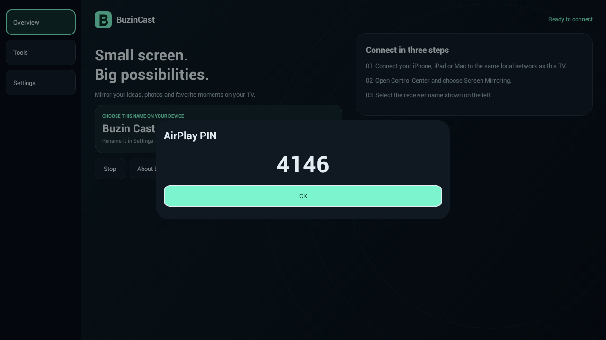
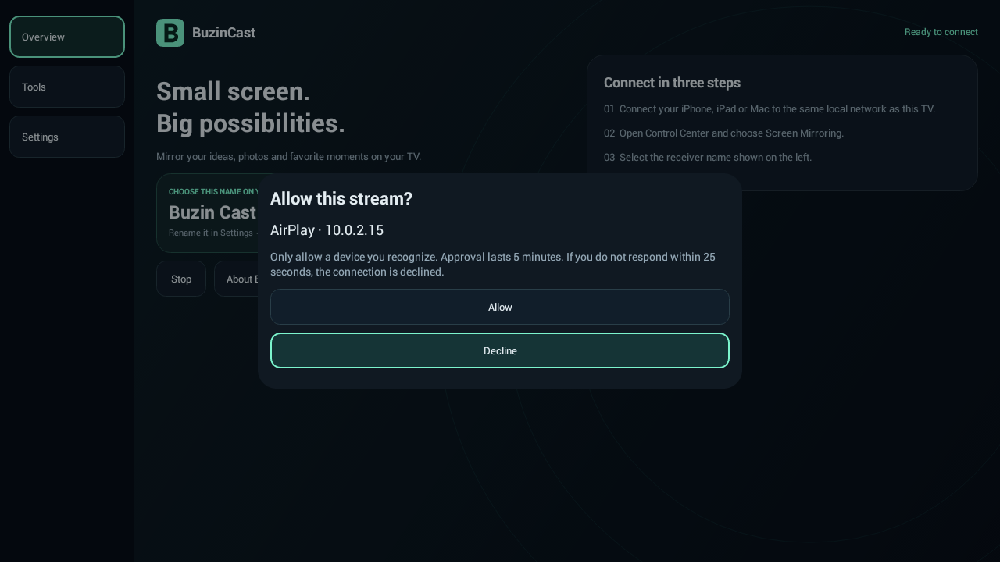
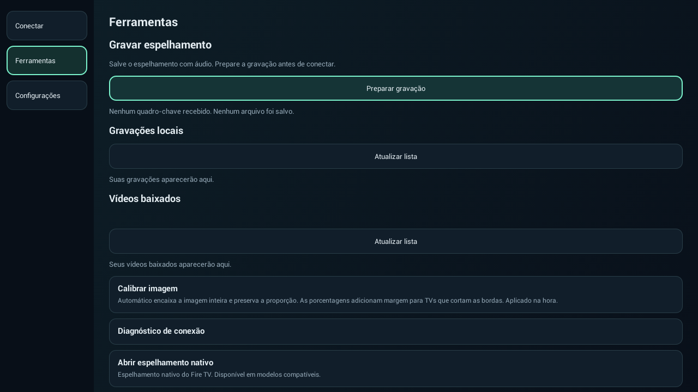

# Testes automatizados

## Transporte de retransmissão na prévia API17

`tools/test_legacy_gestures.py --relay` usa o próprio `MirrorRelay.kt`
copiado da edição moderna, com adaptações de recursos, fila e fábrica do
canal. `SecureMirrorChannel` continua compartilhado: BZCAST02, salt de
16 bytes, PBKDF2-HMAC-SHA1/100.000/256, nonce de 12 bytes, tag GCM de
16 bytes, sequência de 64 bits no AAD, limites e codec dos pacotes.
O construtor aceita uma implementação de cifra; a implementação JVM atual
fica em classe separada e permanece como padrão das edições existentes.
API17 fornece explicitamente o binding OpenSSL, sem carregar o tipo
`GCMParameterSpec` ausente na plataforma. Os testes JVM e o gate de
cobertura do `dlna-domain:check` continuam obrigatórios.

O JNI aceita somente chave de 32 bytes, nonce de 12 e AAD de 8; verifica
tamanhos antes de copiar/alocar, limita o payload ao máximo do canal e
verifica a tag antes de devolver texto claro. Libera contexto e limpa as
cópias nativas de chave, entrada e saída em todos os caminhos. A fila do
adaptador API17 mantém 120 pacotes e acrescenta um teto de 8 MiB; exceder
um limite encerra o envio pela mesma política de rede lenta compartilhada.

`tools/legacy_relay_client.py` usa `cryptography` como testemunha independente
no host. O roteiro verifica código errado seguido de autenticação válida,
keepalive, bytes exatos de vídeo/PCM e End nos dois sentidos, tag alterada,
sequência inválida, tamanho excessivo, truncamento e pacote autenticado
inválido. Também exige recusa quando ocupado e fechamento de conexão parada
antes do handshake. Os testes locais cobrem os limites da cifra e a liberação
do orçamento da fila. O relatório só passa com os 12 estágios independentes
completos, resultado da instrumentação e ausência das threads de transporte.
Os forwards ADB são removidos e os APKs são desinstalados na limpeza.
Não registra códigos de pareamento no relatório do host.

Isso valida o transporte de pacotes, não decodificação de retransmissão,
sessão física, integração ao serviço ou controles da tela Ferramentas.
Esses itens continuam necessários antes de oferecer a função na prévia.

## HTTPS na prévia API17

`tools/test_legacy_gestures.py --https` exige Internet e um emulador API17
isolado. Compara HEAD padrão e TLS 1.2 em três sites públicos; o resultado
HTTP de Amazon/Google é diagnóstico, sem exigir que aceitem HEAD. O vídeo
Sintel da W3C deve responder 200 com TLS 1.2. Depois verifica o player Media3
real, avanço do relógio com tamanho de vídeo, pausa/retomada, foto HTTPS
com redirecionamento e, na edição geral, exportação MP4 com faixas AVC/AAC.
O arquivo de cache é removido do app. A edição geral exige `--ffprobe` e
`--ffmpeg`: uma cópia em `outputs` (ignorada pelo Git) deve conter as duas
faixas com pacotes e decodificar inteiramente sem erro no host. A versão
Base64 temporária no app desaparece junto com a desinstalação de limpeza.
O playback usa `movie_300.mp4` (AVC Baseline, 320×240). O emulador API17
recusou o AVC High Profile do Sintel no decodificador `OMX.google.h264.decoder`;
isso é registrado separadamente da falha TLS original. O exportador continua
usando Sintel, sem precisar decodificá-lo. High Profile no Stick físico
continua sem validação; este teste não comprova essa capacidade.
O extrator da API17 também não enumerou faixas no MP4 High Profile
exportado, enquanto o ffprobe encontrou AVC/AAC e o FFmpeg decodificou ambos.
Por isso o extrator antigo é evidência diagnóstica; a validação independente
é obrigatória, em vez de aprovar o arquivo apenas porque foi salvo.

O fixture local usa a identidade própria do Cast para exigir recusa de
certificado não confiável. Um KeyStore exclusivo do teste confia nessa
identidade: primeiro um handshake bruto deve funcionar; depois HTTPS deve
recusá-la por não corresponder ao domínio. Não altera as raízes ou o
verificador de domínio de produção. O relatório registra os resultados em
`https_probes`; se faltar o artefato, a execução não pode passar.

No Android antigo, TLS 1.2 é suportado desde API16, mas não vem ativado por
padrão antes da API20 ([documentação oficial](https://developer.android.com/reference/javax/net/ssl/SSLSocket)).
`LegacyHttps` ativa TLS 1.2 e cifras AES nas conexões próprias antes da API20,
mantendo as raízes e a verificação de domínio do sistema. Não modifica
fábricas globais nem instala certificados. As versões mais novas mantêm
a configuração da plataforma. O player e o exportador usam o hook
`openConnection` da [Media3 1.2.1](https://github.com/androidx/media/blob/1.2.1/libraries/datasource/src/main/java/androidx/media3/datasource/DefaultHttpDataSource.java),
herdando o tratamento de HTTP, Range, redirecionamentos e erros. O adaptador
fica no mesmo pacote porque o hook é interno; `@Override` exige revisão se
uma atualização o remover. A versão da dependência continua fixada.

Esse ensaio não comprova todos os servidores HTTPS: certificados/raízes
ausentes no firmware, servidores sem TLS 1.2 ou sem cifras comuns ainda
podem falhar. Não cobre emissor físico, DRM ou mídia live.

## Cast V2 experimental na prévia API17

`tools/test_legacy_gestures.py --castv2` verifica o mesmo transporte Kotlin
da produção, alterando somente a fábrica TLS na cópia gerada para API17.
O build confere âncoras e hash do trecho de identidade substituído, para
exigir revisão se a política TLS do app moderno mudar.

O teste usa TLS 1.2 real, com identidade RSA de 2048 bits criada pelo
OpenSSL incluído. Verifica DNS-SD, heartbeat, recusa de DeviceAuth,
lançamento, URL inválida, LOAD, autoplay desligado, PLAY/PAUSE/SEEK,
volume/mudo e STOP/IDLE. Confere autorização/recusa no controle, quadro
maior que 64 KiB, persistência de certificado entre reinícios e regeneração
após arquivo privado inválido. Encerrar uma conexão sem handshake deve
interromper a operação e liberar todos os objetos/socket nativos.

`tools/legacy_cast_client.py` conecta um cliente OpenSSL moderno do host,
sem reduzir a política de cifras padrão. Um proxy do teste Android só
encaminha os bytes até a interface LAN do emulador. O cliente confere o
certificado público exato, sua assinatura e atributos de não-CA, e troca
mensagens protobuf implementadas independentemente. O relatório separado
`host-tls.json` registra protocolo/cifra; a chave privada nunca é exportada.
Esse cenário requer o pacote Python `cryptography` no host.

A implementação JSSE antiga chegou a passar no teste Android/Android, mas
falhou com o cliente moderno. Sua lista não oferecia cifras atuais em comum;
por isso o servidor usa o OpenSSL incluído, em vez de habilitar cifras
antigas no cliente de teste. A verificação final negociou
`ECDHE-RSA-AES256-GCM-SHA384` em TLS 1.2. O Android 4.2 também interpreta
incorretamente a sequência vazia de BasicConstraints; a identidade exige
a forma DER explícita de não-CA gerada pelo próprio app, verificada de
forma independente pelo cliente do host.

O adaptador de sockets é interno e apenas servidor. IDs nativos não são
endereços de memória; o fechamento remove o ID, interrompe I/O e aguarda a
última referência antes de liberar SSL/contexto/descritor. `liveSockets()`
permite ao teste exigir zero objetos após desligar. Os símbolos OpenSSL
ficam privados no ELF, sem dependência do `libssl.so`/`libcrypto.so` do sistema.
Não testa um emissor físico, certificação Google, serviços protegidos ou
espelhamento Chrome. O HTTPS de saída do player é uma camada separada.

## PIN experimental na prévia API17

`tools/test_legacy_gestures.py --pin` usa `cryptography` no Python do host
e um cliente de teste independente em `tools/legacy_pin_client.py`.
Os pedidos reais usam RTSP, não HTTP: o núcleo tem despacho distinto para
os dois protocolos. O cliente calcula SRP-6a/SHA1, verifica a prova do
servidor e a confirmação AES-GCM da chave Ed25519, verifica a assinatura
do servidor na troca X25519 e envia a resposta de pair-verify.

Um PIN incorreto precisa receber 470. Uma tag GCM adulterada também é
recusada; a tentativa seguinte refaz SRP, pois o núcleo consome o estado
após cada confirmação. Uma confirmação repetida é recusada. Há 18 casos
adicionais de tipos/estado/tamanhos inválidos e chaves SRP inseguras.

A parte Android exige a opção desligada por padrão, repasse ao JNI,
`pw` correto nos registros DNS-SD nativos, quatro dígitos na janela real,
foco em OK, notificação atualizada, abertura em segundo plano e limpeza
ao fechar/desligar/parar. Salva `pin-ui.png` a partir das Views reais.
Os testes JVM verificam preservação de zeros à esquerda, descarte de
códigos inválidos, registro limitado a 16 chaves e invalidação ao fechar
a sessão. Nenhum PIN ou chave privada entra no relatório JSON.

Esse teste comprova o fluxo sintético de pareamento, não interoperabilidade
com um dispositivo Apple físico, retomada de um emissor real já registrado
nem bloqueio universal de todos os caminhos legados do protocolo. O PIN
mantém a indicação experimental do app atual; a aprovação opcional por
controle é um recurso separado.



## Aprovação de conexões na prévia API17

`tools/test_legacy_gestures.py --approval` percorre os caminhos de admissão
reais do receptor nativo (RTSP), FCast e DLNA (SOAP). Confere recusa/aceitação,
foco inicial em Recusar, recusa ao voltar, reutilização de autorização e
isolamento entre protocolos no mesmo endereço. Respostas tardias não podem
substituir uma recusa. O caso de timeout aguarda os 25 segundos reais;
parar o receptor cancela outra solicitação sem aguardar esse prazo.

Também exige que a solicitação em segundo plano reabra a interface e que
ativar a aprovação desconecte um cliente FCast previamente autorizado com
a opção desligada. A aprovação vem desligada por padrão. O teste utiliza
a mesma implementação `ConnectionApproval` do app moderno, copiada sem
alteração pelo build, e salva `approval-ui.png` a partir das Views reais.
Não testa autenticação de PIN nem interoperabilidade com emissores físicos.



## Download de URLs na prévia API17

`tools/test_legacy_gestures.py --download` verifica AVC/AAC em MP4, HLS/TS,
DASH/fMP4 e dois períodos DASH; cabeçalhos HTTP são exigidos em manifestos
e segmentos. Exige arquivo completo, faixas/duração, reprodução local no
Media3, URI FileProvider, biblioteca/exclusão, cancelamento, falha com URI
filha local, limpeza de `.part` e preservação de arquivos preexistentes.
Com `--package com.buzincast.tv.deat.legacy.preview`, exige ausência do
botão e bloqueio de início/listagem/worker na edição restrita.

`--ffprobe <executável>` verifica as faixas e contagens dos seis MP4s
sintéticos. `--ffmpeg <executável>` exige decodificação sem mensagens de
erro, inclusive erros de timestamp que retornam status zero. Os dois
arquivos com quadros B (exportação e reexportação pelo leitor Media3)
precisam produzir os mesmos 120 hashes de quadros da origem.

O OMX do emulador API17 não decodifica AVC Main e seu extrator do sistema
omite faixas com CTTS assinado. Esses dois casos não são usados como
prova de reprodução Main no dispositivo: o leitor Media3 é exercitado
sem decoder, e a validação independente ocorre no host. MP4/HLS/DASH
Baseline também passam por reprodução local real no emulador.

`tools/generate_legacy_download_fixtures.py` gera os padrões AVC/AAC sem
ler mídia pessoal e registra hashes dos recursos. O MPD inclui idioma
`en-US` para verificar a adaptação de idioma ISO3 em API17. Os testes JVM
cobrem prefixos Annex-B mistos/limites, reparo de composição sem alterar
payload/offsets, metadados inválidos/overflow e códigos de idioma.

Captura da tela nativa de Ferramentas em API17, com gravações e downloads:



Os helpers de build/exportação verificam a estrutura dos APKs e os hashes
de cópia. O runner verifica ZIP/CRC antes de ADB e exige `Success` na
instalação: versões antigas do ADB podem retornar código zero com
`INSTALL_FAILED_*`. APK corrompido não conta como falha de execução do app.

## Gravação de espelhamento na prévia API17

`tools/test_legacy_gestures.py --recording` usa H.264 e ALAC sintéticos no
receptor nativo, grava com o mesmo `MatroskaRecorder` da edição principal
e verifica a biblioteca, reprodução local via Media3 com faixa PCM estéreo,
URI de exportação, confirmação de exclusão, captura vazia, limite de memória
e encerramento do receptor com captura armada. `--ffprobe <executável>`
acrescenta uma inspeção independente das faixas e contagens de pacotes;
o MKV sintético fica no diretório de saída antes da desinstalação.

No Android 4.2, o `MediaExtractor` do sistema reconhece o H.264 desse MKV,
mas omite sua faixa PCM. O teste não usa essa omissão para concluir que o
áudio está ausente: confere o formato selecionado no worker do Media3,
e o verificador externo confirma os pacotes de áudio. O mesmo comando
com `--package com.buzincast.tv.deat.legacy.preview` exige que a edição
restrita não exponha os controles nem consiga armar ou listar gravações.

O teste recusa aparelhos físicos e limpa a instalação ao terminar. Não
comprova sincronismo perceptual, uma sessão Apple real ou armazenamento
lento/cheio de um Stick físico.

`tools/test_legacy_app.py --tools-only` captura a tela de Ferramentas,
verifica preparar/parar sem deixar arquivo vazio e exige que esses controles
não existam em DE/AT. `--locales en pt-BR ar` limita os idiomas; sem a opção,
percorre todos. Aceita serial de emulador ou a conexão TCP local de um
emulador, inclusive com servidor ADB isolado. O console autenticado fornece
as imagens. [Referência em pt-BR](images/fireos3-native-recording-tools.png).

## URL pelo servidor nativo API17

`tools/test_legacy_gestures.py --native-url` instala a prévia e testa UxPlay
HTTP -> JNI -> serviço -> Media3, em emulador isolado API17. Usa MP4/HLS/AAC
sintéticos de oito segundos, uma fonte que segura o corpo HTTP e comandos
binários plist, com sessão estável por conexão e UUID distinto por item.
Verifica recursos de `/server-info`, posição/duração/rate/ready, controles
remotos e tecla local, RTP -> URL, EOF/Stop, fechamento de canal pausado ou
tocando, reinício explícito durante reprodução e liberação de `/play` ao
parar o serviço durante carregamento.
O cenário também abre `/reverse`, exige Upgrade PTTH e atende `/event`
com respostas `/action` binárias para playlists master/media. O player
reproduz a playlist reescrita pelo servidor HLS nativo e segmentos HTTP
sintéticos. Verifica prontidão, duração, pausa e busca nesse caminho.
O mesmo cenário aceita `--package com.buzincast.tv.deat.legacy.preview`
com os APKs correspondentes. Não representa sessão com aparelho Apple
físico, HTTPS real, live ou DRM.

## Passagem de saída sem encerrar o receptor API17

`test_legacy_gestures.py --url-service` mantém um socket nativo anterior à
URL através dos controles, Back, erro HTTP e retomada por ALAC. Exige a
mesma sessão nativa e Media3 fechado antes de devolver o ganho ao áudio
nativo. O teste FCast também exige que o receptor permaneça e que seu
codec/Surface estejam retirados enquanto Media3 usa a saída.

O modo nativo de `test_fireos3_probe.py` confirma o detach somente após a
Surface anterior se tornar inválida, incluindo ciclos com codec real e
continuidade da linha de áudio e do socket RTSP. Também verifica reply a
um pedido de detach depois de o worker fechar. Nenhum desses testes é uma
sessão com emissor Apple físico nem certificação dos codecs de cada Stick.

## Legendas externas no API17

O cenário `tools/test_legacy_gestures.py --url-service` também exercita CC:
resultado de ACTION_GET_CONTENT, ContentProvider de dados sintéticos do APK
de testes, importador compartilhado de SRT/VTT, preservação de pausa,
posição e velocidade, cues reais e texto na View, desativação e rejeição de
UTF-8 inválido, formato incorreto, mais de 2 MiB e URL remota.
O teste verifica a preservação de pausa antes de dar Play para observar
os cues: o renderer de texto Media3 1.2.1 processa esses cues ao iniciar.
O provider fica explicitamente no primeiro DEX para poder iniciar sozinho
na API17. Não existe no APK do aplicativo.

O cenário `--dlna` acrescenta uma troca de legenda com atraso HTTP maior
que o intervalo do tick de transporte. Buffering não pode se transformar
em Pause, e a reprodução deve retomar com a legenda.

## DLNA no frontend API17

Compile com `tools/Build-FireOs.ps1 -Target legacy -Instrumentation -Check`.
O runner `tools/test_legacy_gestures.py` aceita `--dlna` como cenário separado
de `--fcast` e `--url-service`, com os mesmos argumentos de ADB, APK e test-APK.
O dispositivo precisa ser um emulador API17 isolado; o roteiro instala os
APKs de prévia, usa mídia sintética local e desinstala ao terminar. Para a
edição regional, compile com `-NoDownload` e passe o package
`com.buzincast.tv.deat.legacy.preview` e os APKs exportados dessa edição.

O cenário verifica SSDP, descrição UPnP, comandos SOAP de vídeo/posição,
erro de validação assíncrona sem queda de processo, foto HTTP, giro/escala,
limpeza de cache em erro e ciclo de desativar/reativar DLNA. As versões
compartilhadas dos transportes são compiladas no próprio frontend API17;
não é uma simulação do contrato do protocolo. Esses testes não certificam
emissores externos, rede física, GENA/volume ou todos os controles de fotos.

## Verificação da atualização 0.6.6 — 15/nov/2026

- Principal e compatível de produção compiladas para ARM32/ARM64 com lint
  vital; códigos 42 e 40. ZIPs íntegros e certificado de produção iguais.
- 304 strings suecas e parâmetros de formatação conferidos contra o inglês;
  os 22 idiomas próprios têm todas as chaves traduzíveis do app.
- Interface sueca e 11 conjuntos de localizações da loja capturados no
  Fire TV Stick do quarto (AFTMM/API 25). Capturas regionais 0.6.5 em
  alemão/inglês. Não representam teste físico em todas as gerações.
- `tools/verify_brand.py` passou: 12 recursos do launcher preservados.
- Classes do SDK Amazon preservadas nos DEX e ausência de `capture_locale`
  nos APKs finais conferidas. O mecanismo temporário usado nas capturas foi
  removido antes dos builds finais e não integra o código de produção.
- Licença por instalação oficial/LAT e aprovação da Amazon continuam
  pendentes; não inferir aprovação a partir do sideload local.

A versão 0.6.0 acrescenta testes de comportamento e medição de cobertura. Automação completa dos comandos da suíte não equivale a cobertura de 100% do aplicativo nem a compatibilidade garantida com todos os emissores e aparelhos físicos.

## Plano de compatibilidade dos Fire TV Sticks

### Próxima versão 0.6.7 — trabalho iniciado

- **Media3/API17 — 18/nov:** backend 1.2.1, sem alterar o minSdk 17.
  `tools/test_fireos3_probe.py --url-player --cycles 2` passou em
  `outputs/legacy-media3-formats-final`. Ensaia MP4, HLS/MPEG-TS, DASH/fMP4 e
  AAC silencioso, MIME em URLs sem extensão, cabeçalhos em playlists/segmentos,
  busca/quadro, controle, troca de Surface, EOF/repetição, erro/recuperação e
  substituição de carga. O AAC avançou aproximadamente 0,52×/2,09× e
  0,51×/2,05× ao configurar 0,5×/2×. O teste usa também um segmento local
  válido numa playlist HTTP: deve falhar na validação de URI sem ler o arquivo.
  Fixtures sintéticas de 8 s, hashes e gerador ficam no repositório; mídia e
  endpoints pessoais não entram nele. Relatórios de integração:
  `outputs/legacy-media3-transition-final`, `outputs/legacy-media3-fcast-final`
  e `outputs/legacy-media3-fcast-nodownload-final`. O teste `--url-service`
  cobre seletor por DPAD, pausa/foco, encerramento e áudio nativo/foco no mesmo
  processo após liberar o player. FCast exercita velocidade inicial e opcode
  10, incluindo o estado devolvido ao emissor. Os limites 10/15 s e falhas de
  rede lenta não foram ensaiados; também faltam HTTPS real, live, DRM, troca
  de bitrate e memória com conteúdo longo. Não implica paridade ou teste físico.
  As três integrações e os dois ciclos do probe passaram. Build ARMv7/x86,
  lint e testes JVM passaram em ambas as edições. Foram conferidos hashes,
  versão da biblioteca e licença nos APKs, ausência de fixtures no APK do app
  e preservação das 12 imagens aprovadas do launcher.

- **FCast/API17 — 18/nov:** `tools/test_legacy_gestures.py --fcast` usa o
  mesmo transporte de produção compilado no app moderno. Testa PTR/TXT reais,
  handshake TCP, ping, validação de fonte, HTTP/MP4, cabeçalho customizado,
  pausa, busca, volume e estado, retomada/parada, reabertura de porta e prazo
  de quadro incompleto. Um peer RTSP ocioso deve impedir a tomada do player
  pelo FCast; após fechar o peer, o carregamento deve funcionar. Verifica a
  liberação do multicast/worker ao desligar a opção. O contador tem um teste
  JVM para conexões, fechamento e callbacks tardios. O cenário encontrou a
  ausência da callback do logger nativo: um reset de socket abortava o
  processo. A instalação do sink antes de `raop_init2` permite registrar o
  aviso e concluir o mesmo cenário. Relatórios locais:
  `outputs/legacy-fcast-final`, `outputs/legacy-fcast-nodownload-final`,
  `outputs/legacy-fcast-native-regression` e
  `outputs/legacy-fcast-url-regression`. O runner captura logcat nas falhas.
  As quatro suítes passaram no emulador API17/1280×720, com build ARMv7/x86,
  lint e testes JVM aprovados para as duas edições.
  O backend desse ensaio antigo aceitava apenas velocidade 1; a etapa Media3
  acima substitui essa limitação. Os testes são
  sintéticos em emulador; não validam hardware físico ou emissores externos.

- **URL no serviço/API17 — 18/nov:** `--url-service` em
  `tools/test_legacy_gestures.py` verifica a transferência do receptor nativo
  para MediaPlayer e o retorno após Voltar, Parar e erro HTTP. Usa o serviço
  e a TextureView reais, cabeçalho HTTP, MP4 sintético 160×90/4 s, verificação
  de pixels, callbacks da UI, teclas de mídia, pausa, busca ao início e foco
  transitório/permanente com recuperação explícita. Liberar a tecla de busca
  não deve recuperar foco. O fechamento precisa terminar antes de recriar o
  receptor; o teste espera o worker fechar. Relatórios locais finais:
  `outputs/legacy-url-service-final` e
  `outputs/legacy-url-service-nodownload-final`. Build/lint ARMv7/x86 e testes
  JVM das duas edições passaram, assim como as duas suítes finais API17.
  A regressão nativa está em
  `outputs/legacy-url-service-native-regression` (controles, metadados,
  AudioTrack sem metadados, foco e três ciclos de espelhamento sem tela).
  A descoberta nativa é suspensa durante o player local. Ainda faltam os
  adaptadores DLNA/AirPlay por URL e os demais formatos/funções; esse ensaio não
  comprova reprodução por URL iniciada por um emissor nem paridade completa.

- **Backend de URL API17 — 18/nov:** `LegacyUrlPlayer` isola MediaPlayer,
  preparação, leitura de posição e Surface em HandlerThread. A carga retorna
  um identificador; consumidores devem comparar `State.generation` para não
  confundir estado da fonte anterior. Pedidos substituídos são ignorados,
  assim como callbacks do player antigo. Pausar antes do primeiro Start é
  idempotente; posição inicial aguarda SeekComplete antes de iniciar;
  reproduzir após término reinicia o ticker e o estado READY.
  `LegacyUrlRequestTest` acrescenta quatro testes JVM para URL/posição,
  cópia imutável de cabeçalhos, bloqueio de credenciais/esquemas locais,
  injeção/framing e limites. O build do runtime/probe ARMv7/x86 e lint passou.
  `tools/test_fireos3_probe.py --url-player --cycles 2` executa somente essa
  suíte no probe e descreve esse escopo no relatório, sem marcar testes de
  RTSP/streaming como realizados. Passou em `outputs/legacy-url-player-verified`.
  O servidor HTTP real valida o cabeçalho da fixture e oferece ranges;
  não se exige uma requisição de range para um seek já coberto pelo cache.
  Verifica dimensões 160×90, posição inicial de 1 s, pausa antes de começar,
  avanço de tempo/quadro, pausa, busca para zero, Surface retirada/substituída,
  fim, novo Start após fim, 404, recuperação, substituição rápida e liberação.
  O MP4 sintético de 4 s foi gerado com:
  `ffmpeg -f lavfi -i testsrc=size=160x90:rate=15 -t 4 -an -c:v libx264 -pix_fmt yuv420p -profile:v baseline -g 15 -bf 0 -movflags +faststart url_sample.mp4`.
  O primeiro roteiro encontrou estado FAILED antigo antes de o worker
  aceitar a nova fonte; agora espera o identificador retornado pela carga.
  `legacy-url-player-controls` teve um ciclo aprovado e perda de ADB no
  segundo; a rodada final completa passou em servidor ADB separado.
  **Este ensaio da base não cobre integração; a suíte do serviço está acima.**
  Não anunciar reprodução por URL na prévia por esse teste. HTTPS real,
  HLS/DASH, áudio por URL, legendas, velocidade, recuperação/timeout e
  integração aos protocolos continuam pendentes, junto da investigação nativa.

- **Diagnóstico do encerramento nativo — 18/nov:** `StreamingSelfTest`
  registra o último estágio em `BuzinLegacyStream`: criação da sessão,
  fixtures de codecs, descoberta/RTSP, áudio nativo, relógio A/V, troca de
  Surface, vídeo final e parada. O runner registra `apk_sha256`, salva
  `cycle-N-phases.txt` a cada ciclo e mantém logcat completo nas falhas.
  Um erro apenas na coleta adicional é registrado como diagnóstico;
  os testes de streaming e a limpeza continuam sendo obrigatórios.
  `outputs/legacy-native-phase-stress` passou com `--cycles 3`: seis sessões
  de streaming no emulador API17, incluindo decodificação/áudio, relógio,
  troca de display, RTSP fechado e captura com pixels. Build ARMv7/x86,
  lint e testes JVM do runtime/probe passaram. O arquivo `final-phases.txt`
  preserva também a coleta manual da rodada; logs antigos podem ser evictados
  do buffer Android, por isso as próximas rodadas salvam por ciclo.
  **A falha inicial em dlfree continua sem causa confirmada.** Não foi
  aplicada correção de memória; seis sessões aprovadas não provam sua
  resolução nem substituem testes com transmissor e Stick físicos.

- **Áudio sem metadados API17 — 18/nov:** a mudança de estado da saída
  AudioTrack notifica o serviço. O ganho começa em zero e aguarda foco;
  não depende de título, capa ou identidade DACP. Sem comandos disponíveis,
  não registra botões de música. A saída ociosa libera foco, mantendo um
  bloqueio por perda permanente até ação explícita; pacotes novos não devem
  reativar som bloqueado. A fixture do APK de teste compartilha os assets
  sintéticos do probe, sem acrescentá-los ao APK do app.
  `tools/test_legacy_gestures.py --system-media` acrescenta ALAC pelo decoder
  nativo e AudioTrack silenciado, disputa de foco, liberação por inatividade,
  retomada, perda permanente através da inatividade e reinício explícito do
  receptor. As duas rodadas completas passaram em
  `outputs/legacy-plain-audio-general-verified` e
  `outputs/legacy-plain-audio-regional-verified`; builds/lint e 62 testes JVM
  passaram. Os runners também aceitam `--adb-server-port 5038 --serial
  127.0.0.1:5561` após conectar esse servidor ao emulador. Só aceitam TCP de
  loopback nas portas ADB de emuladores e conferem API17 e a propriedade QEMU.
  O fallback de captura nesse transporte usa o console autenticado local e
  a mesma verificação de pixels. Falhas do probe salvam `failure-logcat.txt`.
  **Regressão ainda com pendência:**
  `outputs/legacy-plain-audio-native-regression` registrou encerramento
  nativo com endereço inválido em `dlfree`. As tentativas seguintes incluem
  perda de ADB e falha do antigo comando de captura pelo serial TCP.
  `outputs/legacy-plain-audio-native-final` completou streaming e captura,
  mas não comprova correção da falha nativa inicial, cuja causa continua
  em investigação. Não declarar estabilidade de produção ou compatibilidade
  física a partir desses resultados.

- **Foco de áudio durante espelhamento API17:** a posse do foco é independente
  do registro de botões/capa de música. Entrar em espelhamento retira o cliente
  de música, preservando foco e ganho. Os callbacks de foco têm geração própria
  e continuam válidos sem `RemoteControlClient`. Ducking reduz o ganho a 20%;
  perdas transitória/permanente silenciam. A permanente bloqueia o retorno
  automático mesmo se o Android enviar GAIN depois; Play explícito pode pedir
  foco novamente. A tela e o receptor de teclas usam esse bloqueio na decisão
  entre Play/Pause, e a interface é atualizada ao mudar o foco.
  `--system-media` disputa foco real em cada um dos três ciclos de espelhamento
  sem Surface: ducking, perda transitória e permanente. Nenhum comando HTTP de
  música pode ser enviado nesse intervalo. Após mudar de modo, o ganho deve
  continuar zero até uma única tecla Play/Pause do host gerar Play e recuperar
  ganho 1. O dump `audio-before-explicit-recovery.txt` registra o serviço de
  áudio antes dessa ação. Os testes também repetem RTSP/DNS/HTTP, metadados,
  retorno pelo launcher e retirada do cliente/foco após parar.
  Geral aprovada em `outputs/legacy-mirror-focus-general-fixed`; regional em
  `outputs/legacy-mirror-focus-regional-final`, ambas em API17/1280×720.
  Builds ARMv7/x86, lint e 62 testes JVM passaram nas duas edições. O primeiro
  teste (`legacy-mirror-focus-general`) encontrou som restaurado após a perda
  permanente; o bloqueio local corrigiu o caso. Os APKs temporários foram
  removidos. Não são sessões com transmissor real nem testes físicos; foco
  em áudio sem metadados e transições com vídeo real permanecem pendentes.

- **Isolamento música/espelhamento API17:** o primeiro pacote de vídeo aceito
  inicia o modo de espelhamento antes da decodificação, inclusive sem tela
  anexada. O estado de vídeo efetivamente exibido é separado. Entrar/sair
  invalida trabalho de metadados em andamento, remove capa/faixa/progresso e
  controla a aceitação de novos pacotes. Metadados e transições de modo são
  serializados na fila de callbacks. O serviço suspende os controles de
  música e o cliente de mídia do Android enquanto o modo estiver ativo.
  Após o reset, novos metadados são aceitos sem ressuscitar os anteriores.
  `tools/test_legacy_gestures.py --system-media` acrescenta três ciclos sem
  Surface, usando o callback nativo de vídeo e um TEARDOWN RTSP com plist de
  stream 110. Verifica isolamento de metadados/imagem/progresso, retirada e
  retorno do cliente do sistema, novos dados de música e preservação da
  instância/porta/endereço do receptor. O XML da interface após abrir pelo
  launcher deve conter o título novo da fixture, `Test`.
  Requer emulador API17 com pelo menos 1280×720; iniciar com
  `-skin 1280x720 -dpi-device 160`. A resolução é registrada no relatório,
  e o roteiro recusa displays pequenos antes de instalar os APKs.
  Geral aprovada em `outputs/legacy-mirror-general-tv`, regional em
  `outputs/legacy-mirror-regional-tv`, com `return-ui.xml` preservado.
  Builds ARMv7/x86, lint e 62 testes JVM passaram nas duas edições. A regressão
  de decodificação/áudio/display passou em `outputs/legacy-mirror-native-regression`.
  A cópia de APKs usada para começar o teste enquanto o lint terminava tem
  os mesmos hashes da exportação final. APKs temporários removidos.
  A fixture de transição usa pacote codificado sem SPS, sem alegar decodificar
  esse pacote nem negociar uma sessão de um transmissor real. A regressão
  separada usa H.264 e áudio sintéticos; não é certificação física.
  As tentativas `legacy-mirror-general-verified` e
  `legacy-mirror-regional-verified` encontraram problemas do roteiro: caminho
  de dump não disponível e display padrão de telefone com título fora da
  área visível após rolagem. O caminho passou a `/data/local/tmp`, removido
  ao concluir, e as duas rodadas completas posteriores em formato de TV passaram.
  Transições com vídeo real e testes físicos ainda
  precisam avançar, junto dos demais itens de paridade.

- **Cliente de mídia do sistema API17:** o serviço registra um
  `RemoteControlClient` com receptor privado de teclas e identificação da
  ativação. Activity e receptor usam a mesma semântica de pressionar/soltar.
  Título, artista, álbum, gênero, duração e uma cópia independente da capa
  chegam ao cliente da plataforma; o Android pode reciclar sua cópia sem
  invalidar a imagem da interface. Pausa/reprodução, anterior/próxima e
  avanço/retrocesso funcionam com o app atrás do launcher. Perda transitória
  ou permanente de foco silencia a saída e pede pausa ao transmissor;
  ducking reduz o ganho local a 20%. Recuperar foco não envia reprodução
  automática. Reprodução explícita tenta recuperar o foco antes do comando.
  A parada retira cliente, teclas e foco; o foco durante vídeo segue a política
  independente descrita acima. Callbacks e
  eventos de ativações anteriores são ignorados.
  O cliente existe desde API14; a atualização externa de posição usa a
  sobrecarga de API18 em classe isolada. No API17, o relógio continua na
  interface e o sistema recebe estado/duração, sem anunciar busca absoluta.
  Referências: [RemoteControlClient](https://developer.android.com/reference/android/media/RemoteControlClient)
  e [AudioManager](https://developer.android.com/reference/android/media/AudioManager).
  `tools/test_legacy_gestures.py --system-media` implica `--metadata` e
  `--controls`, com os mesmos argumentos de APK, test APK, serial e pacote.
  A instrumentação confere metadados e propriedade da capa no cliente real,
  provoca disputas reais de foco e verifica ganho e comandos HTTP. O host
  envia teclas pelo Android com a Activity em segundo plano, confere a
  associação do cliente em `dumpsys audio`, retoma pelo launcher, espera o
  encerramento RTSP e confirma que Play não religa o receptor parado.
  Geral aprovada em `outputs/legacy-system-media-general-final`; regional
  em `outputs/legacy-system-media-regional-checked`. Builds ARMv7/x86,
  lint e 60 testes JVM passaram nas duas edições. A regressão nativa passou
  em `outputs/legacy-system-media-native-regression`, incluindo áudio,
  vídeo, troca de display e início sem tela. APKs temporários removidos.
  As primeiras tentativas preservam falhas do roteiro: nome do campo de
  artwork diferente no API17, retorno criando outra Activity e checagem de
  porta antes de concluir a parada assíncrona. A rodada
  `legacy-system-media-regional-diagnostic` sofreu queda de ADB; a execução
  completa posterior passou. Não são testes em Fire Stick físico nem com
  transmissor Apple real; áudio usa as amostras sintéticas já documentadas.
  Alternância completa áudio/espelhamento e os demais protocolos continuam
  no plano, assim como segurança/licença e os artefatos de produção.

- **Faixa/capa/progresso API17:** callbacks de metadados, imagem e contadores
  RTP chegam ao estado da sessão e à interface nativa. Título, artista, álbum,
  capa e relógio substituem as instruções de conexão durante a reprodução.
  O parser DMAP é atômico: pacote truncado ou inválido preserva a faixa válida
  anterior. Limites: 64 KiB por pacote, 8 KiB por texto, 256 registros e oito
  níveis de contêiner. A capa é decodificada fora da UI, com limite de 4 MiB
  codificados, 64 megapixels de origem e amostragem para até 512 pixels por eixo.
  A fila mantém só o último evento pendente de cada tipo; uma troca de
  transmissor invalida trabalho antigo, limpa a capa e zera o progresso.
  Bitmaps já publicados não são reciclados enquanto a UI ainda pode usá-los.
  O relógio trata rollover unsigned de 32 bits, limites da faixa, pausa e
  relatórios degenerados. Um progresso recebido antes do ACK de Pausar não
  cancela esse ACK; um encerramento nativo posterior continua vencendo uma
  resposta atrasada de Reproduzir. A notificação recebe título/artista, sem
  gravar esses dados em logs. O ticker da tela para ao sair da Activity.
  O anúncio RAOP inclui `md=0,1,2`, com os três bits de metadados no anúncio
  principal. Áudio continua comprimido (`cn=1,2,3`), sem anunciar PCM bruto.
  `tools/test_legacy_gestures.py --metadata` executa também o roteiro de
  controles. Os pacotes de faixa/capa/progresso são **sintéticos**, injetados
  nos callbacks C em um worker nativo; isso não é um emissor RTP completo.
  O ensaio verifica os pixels/proporção da capa, UTF-8, avanço e pausa do
  relógio, descarte de dados inválidos e limpeza na troca de transmissor.
  A imagem `metadata-ui.png` é um render da hierarquia real de Views no
  emulador, sem captura da Surface de vídeo. A transferência Base64 é só do
  APK de teste: o adbd API17 não implementa `exec-out` e seu PTY altera bytes
  binários. Não foi acrescentado comando externo de teste ao aplicativo.
  Metadados/capa no cliente de mídia do sistema e interoperabilidade com
  emissores reais continuam sendo etapas separadas.
  A geral passou em `outputs/legacy-metadata-general-final-checked`; a regional
  em `outputs/legacy-metadata-regional-final`. A [prévia nativa](images/fireos3-native-metadata.png)
  foi inspecionada visualmente. Os 60 testes JVM do alvo antigo, builds ARMv7/x86
  e lint passaram nas duas edições. A regressão nativa passou em
  `outputs/legacy-metadata-native-regression`, incluindo DNS-SD com os bits
  e `md` novos, áudio, vídeo, relógio e troca de display. Gestos da regional
  passaram em `outputs/legacy-metadata-regional-gestures`.
  `outputs/legacy-metadata-general-ui-verified` passou em inglês/árabe, com
  Sobre, foco/bordas, opções avançadas, perfis, nome/porta e calibração.
  A revisão também corrigiu literais Java corrompidos (menos, separadores,
  copyright e marca registrada). A interface do Sobre foi inspecionada nos
  dois idiomas. A conferência focada `--about-only --locales ar` passou em
  `outputs/legacy-metadata-about-rtl-check`, com XML para inspeção dos limites
  dos textos. O gesto de rolagem dos scripts API17 foi corrigido: essa versão
  de `input swipe` aceita quatro coordenadas, sem duração. O wrapper passou
  a rejeitar a mensagem de uso do comando em vez de aceitar um gesto ignorado.
  As primeiras falhas estão preservadas em `outputs/legacy-metadata-first-build.log`,
  `outputs/legacy-metadata-general-first`, `outputs/legacy-metadata-general-verified`
  e `outputs/legacy-metadata-general-ui`. Todos os roteiros finais removeram
  os APKs temporários; nenhuma TV física foi usada.

- **Controles do transmissor API17:** os callbacks de identificação DACP e
  fim do áudio chegam do UxPlay ao runtime. O controlador usa a descoberta
  JmDNS da própria sessão e aceita um endpoint IPv4 da mesma rede local.
  Os botões aparecem após resolver o transmissor; incluem anterior, pausa/
  reprodução, próxima e volume do transmissor. As teclas de mídia também
  enviam comandos, com retomada ao soltar avanço/retrocesso. O observer
  atualiza os widgets existentes, preservando toque e foco.
  HTTP acontece num worker com fila limitada e timeouts. O token de controle
  fica ligado ao endpoint e à geração capturados; respostas antigas não
  alteram outra sessão nem desfazem um encerramento nativo posterior. Erros
  e redirecionamentos não mudam o estado de reprodução. Identificações
  repetidas compartilham uma resolução em andamento. Parar cancela a fila.
  O corpo HTTP não é baixado: só o status confirma o comando.
  Os testes JVM usam sockets HTTP reais, incluindo todos os nove comandos,
  redirecionamento, erro, troca durante resolução/comando, encerramento e
  injeção de cabeçalhos. O modo `tools/test_legacy_gestures.py --controls`
  usa um transmissor local no APK de teste: publica DNS-SD, entrega as
  credenciais por uma requisição RTSP ao receptor nativo e verifica HTTP
  gerado por toque/teclas, foco, falha e troca do transmissor.
  Esse ensaio não comprova interoperabilidade com um emissor físico, nem
  implementa sozinho metadados/capa ou a sessão de mídia do sistema antigo.
  A captura `outputs/legacy-dacp-packets.pcap` mostrou a consulta correta
  antes de os anúncios terminarem; uma consulta única de quatro segundos
  perdia os controles. A descoberta agora faz até três consultas limitadas,
  sem alterar o anúncio tardio do teste. As primeiras reprovações ficam em
  `outputs/legacy-dacp-general-controls`, `outputs/legacy-dacp-regional-diagnostic`
  e `outputs/legacy-dacp-packet-diagnostic`. A próxima rodada
  (`outputs/legacy-dacp-requery-controls`) passou pelos comandos e troca de
  transmissor, mas encontrou perda de foco ao tocar Parar. O clique agora
  atualiza os widgets existentes, em vez de reconstruir a tela. O roteiro
  completo passou em `outputs/legacy-dacp-focus-verified`, com remoção dos
  APKs ao final. Os sete testes JVM do controlador, os demais 48 testes do
  alvo antigo, build ARMv7/x86 e lint passaram na edição geral.
  A edição regional repetiu o roteiro completo com sucesso em
  `outputs/legacy-dacp-regional-verified`; build/lint e os 55 testes do alvo
  antigo passaram nela também. A regressão nativa em
  `outputs/legacy-dacp-native-regression` passou em um ciclo completo, com
  duas sessões, áudio, vídeo, relógio, descoberta e troca de display.
  Os gestos durante reinício passaram em `outputs/legacy-dacp-general-gestures`
  e `outputs/legacy-dacp-regional-gestures`. Os APKs exportados permaneceram
  iguais entre o teste de controles e o de gestos de cada edição. Todos os
  roteiros removeram suas instalações temporárias; nenhuma TV física foi usada.

- **Recuperação de rede API17:** o serviço observa a interface IPv4 em um
  worker, com verificações periódicas e sinal de conectividade do sistema.
  Sinais repetidos não encerram a sessão. Uma mudança de interface/endereço
  retira a descoberta antiga, fecha o receptor e inicia uma sessão ligada ao
  novo endereço; a identidade persistida permanece. Sem rede, o pedido de
  início fica aguardando e Parar continua disponível. A espera mantém a
  notificação, sem manter o wake lock do receptor nativo. Parar, suspensão
  por configuração e destruição cancelam o monitor e tentativas pendentes.
  A preferência traduzida de recuperação pode desativar a retomada automática.
  Falhas no início têm três novas tentativas com espera crescente; notificações
  idênticas não renovam esse orçamento. Uma rede diferente, início manual ou
  30 segundos de sessão estável permitem uma nova sequência. Três testes JVM
  conferem os limites, prazos e cancelamento.
  `tools/test_legacy_network.py` aceita somente emulador API17 com interface
  padrão e root, troca seu IP e derruba sua interface de verdade, consulta
  RTSP e DNS-SD, confere a identidade, o cancelamento e a opção desligada.
  A conferência DNS acontece em outro processo, no APK de prova, e exige
  PTR/SRV/TXT de áudio/vídeo e o registro A do endereço atual. Não há hook
  de teste no aplicativo. O `finally` restaura a interface e remove os APKs.
  Isso não substitui testes em roteadores, emissores e Sticks físicos.
  Os sete cenários passaram nas duas edições em
  `outputs/legacy-network-general-final` e `outputs/legacy-network-regional-final`,
  com restauração da interface e remoção dos APKs ao final. Builds ARMv7/x86,
  lint e 48 testes JVM do alvo antigo passaram. A regressão do runtime passou
  em dois ciclos em `outputs/legacy-network-runtime-regression`, incluindo
  DNS/RTSP, início sem display, formatos de áudio, relógio e troca de Surface.
  A primeira tentativa dessa regressão foi interrompida por perda do daemon
  ADB; o runner interrompido está em `outputs/legacy-network-regression-runner.log`.
  A repetição completa usa `outputs/legacy-network-regression-runner-retry.log`.
  Gestos de toque/DPAD durante reinício passaram nas duas edições em
  `outputs/legacy-network-general-gestures` e `outputs/legacy-network-regional-gestures`.
  A rodada `outputs/legacy-network-service-regression` também passou: mesma
  conexão por Home/Back/nova Activity, morte real do processo debug e
  recuperação sticky, background opt-out, parada explícita, recursos de
  foreground/wake e boot opt-in/out após dois reboots reais do emulador.
  Todas essas rodadas removeram os APKs temporários ao terminar.

```powershell
python tools/test_legacy_network.py --adb <adb> --serial emulator-5560 --apk outputs/fireos/legacy-preview/fireos-legacy-debug.apk --probe-apk fireos3-probe/build/outputs/apk/debug/fireos3-probe-debug.apk
# Edição regional: use o APK exportado de legacy-preview-nodownload e
# --package com.buzincast.tv.deat.legacy.preview.
```

- **Serviço do alvo API17:** `LegacyReceiverService` passa a ser o dono do
  receptor; a Activity observa o estado e oferece/retira a saída de vídeo.
  Home e uma nova Activity mantêm a mesma conexão RTSP com background ligado.
  Com a opção desligada, o servidor fecha ao sair e retoma ao voltar. Parar
  explicitamente não é desfeito por Home/retorno. A notificação foreground e
  o wake lock parcial acompanham a sessão e são liberados ao parar. O serviço
  é privado; o receiver de boot também não é exportado para outros apps.
  `TextureTarget` retém a SurfaceTexture até a view e os wrappers dos decoders
  antigos terem terminado de usá-la. Background segue ligado por padrão;
  início no boot é opt-in. Os textos vêm dos mesmos recursos traduzidos.
  `START_STICKY` recupera uma sessão solicitada após morte do processo, sem
  abrir a Activity. O teste encerra apenas o processo do APK debug permitido,
  identificado pelo pacote/UID, e exige novo PID e receptor respondendo.
  `tools/test_legacy_app.py --lifecycle-checks` acrescenta essa bateria ao
  primeiro idioma, incluindo dois reinícios reais do emulador para boot
  ligado/desligado. `--lifecycle-only` limita a execução a ciclo de vida,
  usando inglês por padrão ou a lista explícita de `--locales`. Todos os
  comandos continuam recusando TVs físicas; os reinícios também conferem
  `ro.kernel.qemu`. O display fica sem sensor de rotação, como num Stick.
  Após reboot, aguarda input dispatch habilitado e descongelado antes de
  desbloquear a tela. Uma execução anterior sofreu congelamento do próprio
  input do emulador (`outputs/legacy-service-regional-ui`); não é aprovação.
  Outra tentativa teve interrupção de transporte ADB (`outputs/legacy-service-ui`).
  O cenário completo geral passou em português em
  `outputs/legacy-service-ui-retry`; a regressão final focada passou em
  `outputs/legacy-service-focused-final`, incluindo morte do processo,
  recursos foreground/wake e boot opt-in/out com dois reboots reais.
  Builds ARMv7/x86, lint e os 45 testes JVM do alvo passaram para as duas
  edições. [Tela real com as opções](images/fireos3-native-service-settings.png).
  Isso não comprova mudança de rede, emissor real ou firmware físico antigo;
  a recuperação de rede ainda precisa ser portada.
  A primeira conferência regional completa (`outputs/legacy-service-regional-final`)
  encontrou navegação perdida durante atualizações do serviço: reconstruir os
  controles entre DOWN/UP podia cancelar o toque. O observer agora atualiza
  apenas os widgets de status e diagnóstico, preservando o menu e o foco.
  `Build-FireOs.ps1 -Target legacy -Instrumentation -Check` gera também um
  APK de teste separado, usando Instrumentation da plataforma e multidex
  apropriado para API17, sem hooks de teste no produto. O runner mantém toque
  ou DPAD_CENTER pressionado, exige o fechamento do socket antigo e uma resposta
  do novo listener, só então libera o gesto e confere a navegação selecionada.
  `tools/test_legacy_gestures.py` instala os dois APKs, executa essa regressão,
  grava hashes/resultado e remove ambos. A geral passou em
  `outputs/legacy-service-gesture-platform-final`. As primeiras tentativas do
  runner sem a preparação correta do classloader estão preservadas em
  `outputs/legacy-service-gesture-final` e `outputs/legacy-service-gesture-verified`.
  Após a correção de interação, a geral repetiu o roteiro completo em português
  em `outputs/legacy-service-stable-final`, incluindo todos os testes de
  background/boot/processo, perfis, nome/porta e calibração. A mesma regressão de
  gestos passou na regional em `outputs/legacy-service-regional-gesture-final`.
  Ambos os relatórios de gestos incluem hashes dos APKs e desinstalação do app
  e do APK de teste. Builds finais com instrumentação e lint também passaram
  nas duas edições; o runner separado não integra o APK do aplicativo.
  A regional concluiu o mesmo roteiro em alemão e árabe em
  `outputs/legacy-service-regional-stable-final`, com os mesmos testes de
  ciclo de vida no primeiro idioma e calibração/controle no segundo.
  A revisão visual encontrou inversão do identificador de versão em árabe;
  o argumento latino agora tem direção explícita e o espaçamento do logo usa
  margem/padding relativos. [Sobre em árabe](images/fireos3-native-service-rtl-about.png).
  Depois desses ajustes visuais, as cópias finais exportadas passaram novamente
  nos gestos em `outputs/legacy-service-general-export-gestures` e
  `outputs/legacy-service-regional-export-gestures`. O script de build agora
  retém cada edição em `outputs/fireos/legacy-preview[-nodownload]`, com
  `artifact.json` contendo ID/versão/hashes. Build sequencial das duas edições
  e verificação dos dois APKs/APKs de teste confirmaram que uma cópia não some
  ao alternar `-NoDownload`. Os diretórios de build do Gradle são temporários.
  A nova rodada árabe também passou em `outputs/legacy-service-rtl-visual-verified`,
  incluindo perfis, nome/porta, controle/toque e calibração; a captura foi
  inspecionada visualmente. Apps/testes foram desinstalados e o emulador próprio
  encerrado. Nenhuma TV física foi usada nesta etapa.


- **Troca da saída de vídeo API17:** `LegacyReceiverSession.setVideoSurface`
  transfere a posse da Surface ao worker do decoder. O alvo ativo só é liberado
  depois do codec; substituições ainda não usadas são descartadas sem esperar
  o worker. O callback de liberação permite ao frontend reter a SurfaceTexture
  antiga até ser seguro liberá-la. Encerramento, falha no início e ofertas
  tardias também liberam os recursos. Três testes JVM exercitam a posse dos alvos.
  Como `MediaCodec.setOutputSurface` só existe a partir da API23, a implementação
  recria o codec antigo, preserva SPS/PPS apenas nas trocas de display e aguarda
  um IDR antes de retomar. Reset do stream invalida essa configuração. Sem
  display, a fila de vídeo continua sendo consumida sem renderizar, mantendo
  áudio e conexão independentes. Um teste JVM adicional verifica a identificação
  de IDR, incluindo cabeçalho inválido e start codes de três/quatro bytes.
  O autoteste real de runtime tira e recoloca a saída duas vezes, verifica
  avanço do AudioTrack sem reset, continuidade da mesma conexão RTSP, liberação
  dos wrappers antigos e novos callbacks de atualização da TextureView.
  Retoma com IDRs reais sem reenviar SPS/PPS. A primeira tentativa, que injetava
  um único quadro e não obteve atualização da tela, foi preservada em
  `outputs/legacy-surface-regression`; o fluxo limitado a três IDRs passou em
  `outputs/legacy-surface-diagnostic`. O ensaio não mede desempenho físico nem
  simula um emissor Apple completo. O serviço/boot e a migração da Activity
  ainda são etapas seguintes; este mecanismo não os implementa sozinho.
  A rodada final `outputs/legacy-surface-headless-final/report.json` passou
  em dois ciclos, com duas sessões completas por ciclo. Cada sessão iniciou
  descoberta/RTSP e reproduziu os quatro formatos de áudio sem display antes
  da primeira conexão da Surface. As retiradas/trocas, a continuidade do áudio,
  do socket e a retomada real da imagem passaram nas quatro sessões. Passaram
  41 testes JVM do runtime, um do probe e três do frontend (45 do alvo antigo),
  builds ARMv7/x86 e lint do probe e das duas edições do frontend. O capturador
  removeu a instalação temporária; o emulador próprio foi encerrado.


- **Perfis no alvo API17:** `LegacyProfiles` usa `QualityProfiles` do
  `receiver-core`, com as mesmas chaves persistidas e os mesmos percentis
  adaptativos do frontend moderno. Uma edição atômica das preferências
  provoca um reinício da sessão. Resolução/FPS chegam ao plist nativo;
  buffer automático usa `TimelineBuffer` adaptativo (cushion 0), enquanto
  Jogos usa 25 ms fixos. O player passa esses valores ao decoder e mede o
  cushion realmente usado pelo buffer. A opção de codec `low-latency` só
  é enviada a partir da API30 e quando a consulta do codec informa suporte.
  Em API21+, os modos vêm de `MediaCodecList`/VideoCapabilities. Antes disso,
  o AFTM/Amazon usa os modos AVC documentados pela Amazon: 1080p/30 e
  720p/30/60. A [ficha de hardware oficial](https://developer.amazon.com/docs/device-specs/device-specifications-fire-tv-streaming-media-player.html?v=ftvstickgen1)
  não substitui validação do firmware original nem mede desempenho real.
  No emulador API17 debug, a capacidade de teste é 720p/30; modelos antigos
  desconhecidos não recebem modos de perfil inventados. Padrão preserva a
  configuração de base 720p/30 quando não há capacidades conhecidas.
  O autoteste de áudio agora decodifica os quatro formatos com buffers
  20 ms, 25 ms e adaptativo, confere o cushion nativo e exige PCM não nulo.
  A bateria do receptor usa 25 ms também no player real e verifica a medida.
  O modo persistente separado anuncia 1080p/30 na porta de teste 17001;
  o script consulta `/info` para verificar a passagem da configuração pelo
  JNI. A verificação de 1080p/30 cobre metadados; a mídia decodificada
  continua sintética e pequena, sem medição de desempenho 1080p/60 físico.
  A rodada final passou em dois ciclos completos em
  `outputs/legacy-profiles-final-verified/report.json`: anúncio alternado
  1080p/30 e 720p/60, áudio real com 25 ms, espera/descarte de vídeo,
  flush e recuperação de áudio após inatividade. São metadados de modos;
  os quadros H.264 da fixture continuam pequenos, sem comprovar desempenho
  físico dessas resoluções.
  O teste revelou que reler um contador AudioTrack antigo sem avanço
  reiniciava a extrapolação. O relógio agora mantém a referência até o
  contador mudar, limita a previsão ao PCM aceito e considera obsoleto um
  contador estacionário após 250 ms. Uma lacuna curta de metadados aguarda
  até 100 ms antes de abandonar a sincronização; vídeo sem áudio e flush
  explícito continuam imediatos. Os limites de descarte e de tolerância
  A/V do teste não foram relaxados. A fila de vídeo comporta 16 quadros,
  suficiente para 250 ms a 60 fps, mantendo o limite independente de 4 MiB.
  A fonte sintética passou a enviar áudio no tempo real por uma thread Java
  existente, sem criar uma pthread a cada pacote; os testes separados de
  callbacks em thread nativa continuam ativos. Isso não altera a anexação
  JNI dos callbacks de rede reais nem substitui teste com emissor físico.
  Tentativas anteriores com falhas de sincronização e interrupção do ADB
  foram preservadas em `outputs/legacy-profiles-*`, incluindo
  `runtime-verified`, `paced-verified` e `clock-diagnostic`; não são evidência
  de aprovação. A rodada final acima foi feita após as correções.
  A interface passou em inglês/português/árabe em
  `outputs/legacy-profiles-ui-verified`: quatro perfis, preferências,
  reinício, seleção persistente, `/info` e calibração/edição de nome/porta.
  A regional passou em alemão em
  `outputs/legacy-profiles-regional-ui-verified`. Passaram 41 testes do alvo
  antigo (37 runtime, um probe, três frontend), 34 do núcleo e 181 do domínio
  compartilhado na verificação; builds ARMv7/x86 e lint das duas edições
  também passaram. [Captura real dos perfis](images/fireos3-native-profiles.png).
  Após o último build, o APK geral repetiu o cenário completo em português
  e passou em `outputs/legacy-profiles-packaged-normal-private-retry`.
  O capturador ganhou `--adb-server-port` para isolar o servidor dos demais
  testes; a primeira tentativa no servidor separado também sofreu uma
  interrupção de transporte e está preservada como `packaged-normal-private`.
  A repetição passou sem reiniciar o emulador, com limpeza da instalação.
  O APK regional final passou no mesmo roteiro em alemão em
  `outputs/legacy-profiles-packaged-regional-private`. Os dois relatórios
  confirmam desinstalação; nenhuma TV física foi controlada.


- **Calibração nativa API17:** a prévia agora depende do mesmo `DisplayFit`
  de `dlna-domain` usado no app moderno. A geometria da calibração e o ajuste
  da TextureView usam esse cálculo comum, incluindo proporção, centralização
  e margem de 0–10% por borda. A calibração é uma camada opaca na própria
  Activity, sem recriar/parar o receptor. Setas alteram o rascunho; OK salva,
  Voltar cancela. Botões também permitem ajuste/Salvar/Cancelar por toque.
  A preferência `tv_margin` só muda ao confirmar e é aplicada imediatamente
  ao transform do vídeo. O rascunho integra o estado salvo da Activity.
  O teste público acrescenta capturas da calibração, medição das quatro
  pontas, limites, persistência/cancelamento e continuidade do socket RTSP.
  `Build-FireOs.ps1 -Target legacy -Check` também executa `dlna-domain:test`.
  A primeira captura encontrou o teclado de extração da API17 sobre o
  ajuste, depois das edições de nome/porta. O editor agora desativa esse
  modo, esconde o teclado antes de ser destacado da janela, bloqueia foco
  enquanto fecha e restaura o modo de janela sem teclado. A chamada adiada
  de abertura também verifica se o editor ainda está visível/focado.
  O capturador exige dois quadros iguais antes de aceitar cada PNG.
  O teste da edição geral passou em inglês, português e árabe em
  `outputs/legacy-calibration-ime-verified/report.json`, incluindo os
  limites de margem, toque/D-pad, salvar/cancelar e continuidade RTSP.
  [Captura real da calibração](images/fireos3-native-calibration.png).
  Build ARMv7/x86, lint, 33 testes JVM do runtime/probe e 145 testes do
  domínio passaram. Não foi negociada uma sessão de vídeo com emissor real
  durante esse teste; o ajuste da saída usa o cálculo comum já exercitado
  pelos testes de `DisplayFit` para fontes 16:10, retrato e ultrawide.
  A edição regional repetiu o cenário completo em alemão e passou em
  `outputs/legacy-calibration-nodownload-verified/report.json`. As duas
  instalações temporárias foram removidas e o emulador próprio foi fechado.

- **16/nov — primeira interface nativa API17:** `fireos3-runtime` agora
  concentra JNI, descoberta e players, compartilhados por `fireos3-probe`
  (autotestes sintéticos) e `fireos-legacy` (interface real em Views, sem
  Compose/Media3). As duas ABIs são ARMv7/x86; os APKs de prévia têm IDs
  isolados, sem assinatura de produção nem licença Amazon integrada.
  O frontend copia strings e imagens diretamente do app atual durante o
  build, sem manter traduções ou logos divergentes. Nome e porta configurados
  chegam ao anúncio mDNS e ao servidor nativo; a string JNI usa UTF-8 padrão.
  A captura real encontrou fallback para inglês no hebraico: a API17 busca
  o código histórico `iw`. O gerador transforma somente `values-he` em
  `values-iw`, preservando o texto da fonte e permitindo a seleção do idioma
  real do sistema antigo. A automação continua pedindo `he` normalmente.
  O Sobre usa uma camada na própria Activity: a janela Dialog da API17
  deixava cantos pretos fora da forma arredondada. A camada prende o foco,
  permite Voltar e preserva o destino ativo atrás. A edição de nome/porta
  abre o teclado sem descartar o modal quando muda a área útil da tela.
  Comandos reproduzíveis (APK de debug, não publicação):

```powershell
./tools/Build-FireOs.ps1 -Target legacy -PosixBin <MSYS2-bin> -Check
python tools/test_legacy_app.py --adb <adb> --serial emulator-5560 --apk fireos-legacy/build/outputs/apk/debug/fireos-legacy-debug.apk
./tools/Build-FireOs.ps1 -Target legacy -PosixBin <MSYS2-bin> -NoDownload -Check
python tools/test_legacy_app.py --adb <adb> --serial emulator-5560 --apk fireos-legacy/build-nodownload/outputs/apk/debug/fireos-legacy-debug.apk --package com.buzincast.tv.deat.legacy.preview --locales de en
```

  Sem `--locales`, testa todos os idiomas próprios. O script confere o foco
  por toque/controle, borda do destino ativo atrás do Sobre e cantos do modal,
  além de comandos RTSP reais para nome, porta e parada. Remove seu pacote,
  XML temporário e túneis ADB no fim. Não abre TVs físicas. A Activity ainda
  encerra o receptor ao ir para segundo plano; serviço/boot são trabalho
  pendente, assim como os protocolos e funções de mídia do app moderno.

  Capturas reais desta prévia: [início](images/fireos3-native-home.png),
  [configurações RTL com foco no conteúdo](images/fireos3-native-rtl-settings.png)
  e Sobre em [português](images/fireos3-native-about-pt.png) e
  [hebraico com destino ativo atrás](images/fireos3-native-about.png).
  Não substituir as capturas da ficha Amazon por essa interface incompleta.

  Evidência da rodada geral: sete idiomas passaram antes da falha de hebraico
  (`outputs/legacy-ui-all-verified/report.json` preserva essa falha). Após a
  correção do qualificador, os outros 15, incluindo hebraico, passaram em
  `outputs/legacy-ui-remaining-verified/report.json`: 22 idiomas conferidos
  no total, não uma execução única sem falhas desde o início. Os controles
  reais de nome/porta/reinício passaram em árabe e hebraico. ARMv7/x86,
  lint e 33 testes JVM passaram nas duas edições; build moderno x86_64,
  lint e `receiver-core:check` passaram após a extração. A regressão do
  receptor compartilhado completou dois ciclos API17 de DNS/RTSP, vídeo,
  quatro formatos de áudio, volume/flush, idle/resume e relógio A/V
  (`outputs/fireos3-shared-runtime-checks/report.json`). Esses fluxos usam
  mídia sintética; não são negociação com um emissor Apple real.
  A prévia regional também passou em alemão e inglês, incluindo
  nome/porta/reinício/parada (`outputs/legacy-ui-nodownload-verified/report.json`).
  Os testes removeram as duas instalações de prévia. Nenhuma TV foi usada.

- **16/nov — protótipo 0.5 com relógio A/V:** o buffer temporal informa
  quais amostras foram realmente aceitas e lidas, separando silêncio de
  priming/underrun, lacunas inseridas, sobreposição descartada e trim.
  Metadados limitados por posição absoluta preservam mudanças de timestamp;
  o PCM e a política de jitter existentes continuam no mesmo caminho.
  `AudioPlaybackClock` relaciona esses intervalos ao head de AudioTrack,
  trata wrap de 32 bits, reset e amostra de relógio antiga. Um bloco conhecido
  que ainda está na fila permite contar o tempo até sua reprodução, inclusive
  após underrun. Não interpola uma mudança de PTS como mudança de sample rate.
  O player H.264 mantém tags relativas no codec e um mapa limitado para o
  NTP original; espera quadros adiantados, descarta atrasos maiores que 150 ms
  e limita a espera a 250 ms. Sem relógio de áudio válido, vídeo segue sozinho.
  O teste aquece o decoder com um fluxo de entrada: uma única imagem na API
  17 não produziu saída. Depois exige o timestamp de origem esperado, espera
  real, desvio de entrega até 25 ms no relógio de software, descarte de quadro
  500 ms atrasado e nova geração de relógio após flush em até 200 ms.
  Isso não mede a latência HDMI/acústica nem substitui emissor/Stick físicos.
  ARMv7/x86, lint e 30 testes JVM passaram. Dois ciclos completos da API 17
  x86 passaram, cada um repetindo a bateria de streaming. Relatório em
  `outputs/fireos3-sync-verified-checks/report.json` e
  [captura do emulador](images/fireos3-avsync-probe.png). O pacote foi removido
  e o emulador fechado. Build moderno x86_64, lint e verificação do núcleo
  também passaram após a alteração compartilhada do buffer temporal.
- Treze testes nativos passaram no emulador API 17, incluindo dez dias de
  posições de stream, gaps/drops, overflow, priming, trim e bounded metadata.
  Os mesmos testes também compilaram para ARMv7. O comando público
  `python tools/build_native_tests.py --legacy --output outputs/native-api17-tests`
  usa NDK r23/C++17 e não exige runtime de cobertura/sanitizer na API 17.
  Sem `--legacy`, preserva o NDK atual, UBSan e cobertura para o CI moderno.
- **16/nov — protótipo 0.4 com áudio do receptor integrado:** os callbacks
  UxPlay `audio_process`, `audio_get_format`, `audio_set_volume`,
  `audio_set_client_volume` e `audio_flush` chegam a uma fila Java limitada
  (64 pacotes/256 KiB; cada pacote até 64 KiB). Um worker próprio possui
  FFmpeg, buffer temporal e AudioTrack; formato/flush descartam a geração
  anterior e liberam o áudio antigo. O stop é idempotente, acorda as filas e
  espera a saída de áudio antes de concluir o encerramento.
  A sessão experimental agora anuncia `_raop` e ALAC/AAC, sem PCM bruto,
  fotos, HLS ou metadados. O alvo moderno preserva seus anúncios anteriores.
  O autoteste usa exatamente os callbacks registrados, em pthreads nativas,
  e exige reprodução do PCM não nulo pelo relógio do AudioTrack silenciado,
  nos quatro formatos. Também consulta os dois serviços por multicast,
  confere volume SET_PARAMETER/GET_PARAMETER em sockets RTSP reais e
  verifica flush sem novo pacote e encerramento do worker.
  Sem pacotes novos por dois segundos, a saída também é liberada; a suíte
  exige que volte a reproduzir sem receber nova negociação de formato.
  ARMv7/x86, lint e os 24 testes JVM passaram. Dois ciclos completos da
  API 17 x86 passaram, com a bateria de streaming repetida por ciclo e
  remoção do pacote no fim. Relatório local:
  `outputs/fireos3-live-audio-verified-checks/report.json`;
  [captura do emulador](images/fireos3-live-audio-probe.png).
  Build moderno x86_64, lint e verificação do núcleo também passaram após a
  alteração do shim compartilhado de descoberta.
  Isso ainda **não** testa negociação, criptografia e RTP com um emissor
  Apple real. O relógio de reprodução está exposto ao proprietário da sessão;
  sincronização A/V e migração das telas/funções completas continuam pendentes.
- **16/nov — protótipo 0.3 de áudio para API 17:** o mesmo `FfmpegDecoder`
  e `TimelineBuffer` da produção agora podem ser compilados sem os headers e
  as fábricas de `libmediandk`. O app moderno continua usando seu backend
  habitual. A ponte JNI isolada limita o tamanho dos pacotes, acrescenta o
  padding exigido pelo FFmpeg e serializa decodificação, leitura e destruição.
  O autoteste injeta tons próprios ALAC/352, AAC-LC/1024 e AAC-ELD/480 e /512,
  exige PCM não nulo no buffer temporal e o entrega a um AudioTrack real com
  volume zero, conferindo avanço do relógio. Não é ainda áudio de um emissor
  na rede nem sincronização A/V; o receptor persistente segue anunciando
  somente vídeo. AAC-LC/960 ainda não tem fixture. Geração reproduzível em
  `tools/LEGACY_AUDIO_FIXTURES.md`; FDK AAC é ferramenta de host, fora do APK.
  ARMv7/x86, lint e os 16 testes JVM passaram. Dois ciclos completos do
  emulador x86 passaram, incluindo o áudio duas vezes por ciclo; pacote
  removido no fim. Relatório em `outputs/fireos3-audio-checks/report.json`,
  [captura real do emulador](images/fireos3-audio-probe.png). Os ELF das duas
  ABIs dependem somente de `libm`, `liblog`, `libandroid`, `libdl` e `libc`.
  A regressão do app moderno x86_64 também compilou, com lint e a verificação
  do núcleo aprovados após a mudança no header/CMake compartilhado.
- O indicador do menu lateral agora depende também do destino selecionado,
  além do foco. Deve continuar visível ao entrar no conteúdo e atrás do Sobre.
  O estado selecionado também é exposto à acessibilidade.
- Os modificadores de foco compartilhados recebem foco após um toque
  concluído, sem consumir o clique. Gestos cancelados por rolagem não devem
  mover o foco. Não ampliar os dispositivos da ficha antes da validação.
  `canFocus` é mantido no modo touch, conforme as
  [propriedades de foco do Compose](https://developer.android.com/develop/ui/compose/touch-input/focus/change-focus-behavior).
  As seis verificações do script passaram na API 28, incluindo o contorno
  medido em pixels atrás do Sobre. A TV física não foi usada nesta etapa.
- Principal 0.6.7 debug (46) compilada; compatível (44) compilação Kotlin
  conferida. Lint de ambas passou. Os 25 testes do núcleo e seu limite de
  cobertura passaram. A substituição atômica do snapshot de logs no Windows
  agora usa um backend JVM; o Android injeta seu rename compatível com APIs
  antigas, sem usar `java.nio.file` no caminho da aplicação.
- A prova API 17 agora encaminha o callback `video_process` real do UxPlay
  para Java, usando uma referência global de JNI e anexando/desanexando as
  threads nativas. Uma fila limitada a oito quadros/4 MiB separa a recepção
  da decodificação. Codec incompatível e estouro do orçamento são erros
  explícitos; o encerramento para o receptor antes de liberar a fila.
- Teste sintético: receptor RTSP ativo, callback invocado em pthread nativa,
  fila Java, MediaCodec e Surface. Dois ciclos completos e duas reproduções
  por atividade passaram na API 17 x86, com quadro colorido conferido.
  Isso **não** representa uma sessão real de espelhamento, áudio ou paridade
  com o app principal. A prova mantém um pacote de teste isolado, sem APK
  de produção para Fire OS 3.
- **16/nov — protótipo 0.2:** acrescentados descoberta mDNS/DNS-SD com
  JmDNS 3.6.5, identidade local aleatória persistente (não usa o MAC real),
  TXT e chave pública extraídos do mesmo receptor nativo que possui a porta.
  A biblioteca recebe somente a adaptação UTF-8 necessária para API 17; APIs
  Java adicionais usam desugaring/MultiDex. O `NsdServiceInfo.setAttribute`
  da aplicação atual só existe a partir da
  [API 21](https://developer.android.com/reference/android/net/nsd/NsdServiceInfo#setAttribute(java.lang.String,java.lang.String)).
- `Start experimental video receiver` inicia um receptor persistente de vídeo
  H.264 em uma interface IPv4 privada com multicast. Admissão nativa limitada
  à sub-rede selecionada e loopback; IPv6 de LAN ainda não implementado. Áudio,
  fotos, HLS e H.265 não são anunciados. O player Java configura MediaCodec
  a partir do SPS/PPS Annex-B recebido, acompanha mudanças de configuração e
  descarta a sessão anterior após reset. Sem `libmediandk`.
- `Run streaming stack checks` consulta de fato o grupo multicast usando um
  socket UDP separado, confere PTR/SRV/TXT, porta, chave pública e capacidades;
  faz `OPTIONS` e `/info` no receptor RTSP; injeta vídeo sintético pela thread
  nativa na fila/decodificador persistente e exige atualização da Surface.
  Também confere que a porta TCP fecha ao parar. Dois ciclos completos na
  API 17 passaram, incluindo iniciar/parar o modo persistente entre autotestes.
  Os 16 testes unitários e o lint do protótipo passaram; ARMv7 e x86 compilados.
  **Não houve teste com emissor Apple real nem Stick físico com Fire OS 3.**

```powershell
python tools/test_focus_navigation.py --adb <adb> --serial emulator-5558 --apk app/build/outputs/apk/debug/app-debug.apk
python tools/test_fireos3_probe.py --adb <adb> --serial emulator-5560 --apk fireos3-probe/build/outputs/apk/debug/fireos3-probe-debug.apk
```

Os dois scripts recusam aparelhos físicos. O teste API 17 captura pelo console
do emulador quando o `screencap` antigo retorna um framebuffer preto, e rejeita
uma imagem sem o quadro sintético colorido. Use um emulador com área suficiente
para a prévia (por exemplo, 1280×720). Relatórios e prints ficam em `outputs`.
O teste API 17 faz dois ciclos por padrão (`--cycles 1` permite um ciclo curto),
para e desinstala somente o pacote de teste no fim. `--keep-installed` mantém
o APK parado para investigação manual. Nenhum deles publica na Amazon.
O teste do menu também confere a borda em pixels; sem ela não declara sucesso.
Ele suspende a animação decorativa no emulador durante o teste e restaura a
configuração no fim. Se uma instalação anterior tiver assinatura diferente,
`--reset` remove explicitamente apenas o app e seus dados naquele emulador.
As capturas desta fixture são evidência de teste, não imagens novas da ficha.

Evidências selecionadas sem dados de rede doméstica:
[menu atrás do Sobre](images/0.6.7-about-active-menu.png),
[foco após toque e fechamento](images/0.6.7-touch-focus.png) e
[quadro sintético API 17](images/fireos3-callback-probe.png).

O alvo são todas as famílias de Fire OS que rodaram em Sticks físicos.
Manter as mesmas funções por geração dentro de cada variante regional.
Vega OS é desenvolvido em outro ambiente.

1. **Fire OS 3 (API 17, AFTM no firmware original).** A primeira prova
   passou no emulador x86: Android Views com setas e OK, parser nativo
   e um quadro H.264 decodificado pelo MediaCodec Java. A segunda prova
   carregou a amostra H.264 por HTTP e confirmou um quadro visível na
   Surface do emulador API 17. A amostra agora passa por JNI usando
   `video_decode_struct` e a assinatura `onVideoData(byte[], long, boolean)`
   do receptor. O APK de teste inclui ARMv7.
   O protótipo compila o núcleo UxPlay com OpenSSL, sem vincular
   `libmediandk`. O botão de compatibilidade inclui uma prova RTSP
   local: iniciar, enviar `OPTIONS`, conferir os métodos anunciados
   pelo receptor e parar. Dois ciclos passaram no emulador x86 API 17
   com a resposta RTSP 200, incluindo `SETUP` e `RECORD` no cabeçalho
   `Public`. A ponte do callback de vídeo agora também passa pelo receptor
   ativo e uma thread nativa. O protótipo 0.2 agora tem descoberta multicast e
   player persistente Annex-B/MediaCodec, conforme os autotestes acima.
   Próximo marco: áudio compatível e sessão real com emissor; depois ampliar
   os controles e verificar temporização, reconexão e mudança de rede.
   Depois portar as telas, configurações e funções restantes e validar
   com emissores reais em um AFTM com Fire OS 3.
2. **Fire OS 5 (API 22, AFTM atualizado e AFTT).** Validar os dois
   APKs compat já assinados. Testar primeiro no AFTM de 2014, que é o
   modelo mais antigo, e depois no Stick de 2ª geração e no Basic Edition.
   Conferir instalação, abertura a frio, foco, espelhamento, áudio,
   reprodução e recuperação após interrupção da rede.
3. **Fire OS 6, 7 e 8 (APIs 25, 28 e 30 nos Sticks).** Validar os dois
   APKs principais já assinados. Começar com um Stick 4K de 1ª geração
   no 6, um Stick ou Lite no 7 e um Stick 4K de 2ª geração no 8. Repetir
   os testes principais nos demais modelos do catálogo antes de marcar
   a cobertura de cada modelo. Conferir codecs, controle remoto e
   reprodução prolongada.
4. **Paridade e publicação.** Usar [FEATURES.md](FEATURES.md#disponível-no-código)
   como inventário. Verificar funções de rede, mídia, fotos, legendas,
   gravação, download e retransmissão conforme a variante. Em Alemanha e
   Áustria, validar que download e gravação não podem ser acionados.
   No console, conferir elegibilidade dos Sticks por modelo e país,
   distribuição das variantes e entrega ao firmware Fire OS 3. Validar
   instalação e atualização na loja antes de anunciar cobertura.

Projeção de seis APKs, dois por faixa: API 17, API 22 e API 25 ou superior.
As quatro edições existentes da 0.6.4 já têm assinatura de produção. O
protótipo API 17 é um APK de depuração com ID próprio.

### Reproduzir a prova H.264 na API 17

```powershell
.\gradlew.bat -PbuzinFireOs3Probe=true :fireos3-probe:assembleDebug :fireos3-probe:lintDebug
$serial = 'emulator-5560' # Substitua pelo serial do emulador API 17.
adb -s $serial install -r fireos3-probe/build/outputs/apk/debug/fireos3-probe-debug.apk
adb -s $serial shell am start -n io.buzincast.fireos3probe/.ProbeActivity
```

Navegue com as setas, acione **Run compatibility checks** com OK e
confirme **Native UxPlay HTTP parser: passed**, **UxPlay receiver: RTSP OPTIONS passed**
e **H.264 sample: decoded frame**. O teste RTSP usa um cliente no próprio
emulador e encerra o servidor ao terminar.
A amostra sintética foi criada com:

```bash
ffmpeg -f lavfi -i testsrc2=size=64x48:rate=5:duration=1 -c:v libx264 -profile:v baseline -pix_fmt yuv420p -movflags +faststart fireos3-probe/src/main/res/raw/h264_sample.mp4
```

Para a prova de rede, sirva a mesma amostra no host do emulador:

```powershell
python -m http.server 18765 --bind 127.0.0.1 --directory fireos3-probe/src/main/res/raw
```

No protótipo, acione **Render network sample**. O emulador acessa o host
em `10.0.2.2:18765`. Confirme o GET no servidor, o quadro colorido e a
mensagem **Network H.264 sample: frame displayed**. A mensagem depende de
uma atualização da textura da Surface, com tempo limite de dois segundos
após o envio do quadro. A fonte HTTP é uma amostra de teste. O protótipo
limita o tamanho do arquivo temporário e o remove ao terminar. Com o
servidor desligado, o teste exibiu erro de conexão e a prova local
voltou a decodificar na mesma atividade. A sessão de espelhamento do
UxPlay segue pendente.

## Núcleo e protocolos

```bash
./gradlew :receiver-core:check :receiver-core:jacocoTestReport :dlna-domain:test assembleDebug lintDebug
```

`receiver-core` não depende de Android. Os testes verificam exclusão entre sessões, substituição e eventos atrasados, disputa entre threads, encerramento dos adaptadores mesmo após falhas, escrita de logs fora do chamador, rotação, pressão na fila, falhas de disco, negociação dos perfis e orçamento de recuperação por sessão.

O gate do núcleo exige pelo menos 90% de cobertura de linhas e 80% de decisões. A cobertura efetiva é publicada em `receiver-core/build/reports/jacoco/test/html/index.html`; nenhum teste é dispensado para atingir o número. Os 145 testes de domínio (incluindo a regressão SOAP) DLNA, quadros FCast/Cast, gravação e ajuste de imagem continuam em `dlna-domain`.

## Interface e integração no emulador

Em um emulador isolado, com ADB autorizado:

```bash
python3 tools/test_emulator.py --serial emulator-5554 --apk app/build-coverage/outputs/apk/debug/app-debug.apk
```

O script recusa serial físico ou IP. Usa apenas a biblioteca padrão Python. Instala o debug APK, usa a navegação lateral e os controles reais em uma atividade exclusiva de debug, ajusta preferências do emulador, gera áudio silencioso sintético e simula uma falha HTTP. Não conecta nas TVs da rede. No fim, encerra o app no emulador e restaura os overrides de tamanho/densidade.

Os cenários são:

- Percorrer configurações normais e avançadas, inclusive valores personalizados, sem abertura do teclado.
- Abrir edição com OK, cancelar sem salvar e recuperar o foco anterior.
- Preencher o formulário único de outra TV por controle remoto, com navegação sem teclado automático.
- Aplicar os perfis usando capacidades reais informadas pelos codecs do emulador.
- Gravar uma transmissão H.264/AAC sintética, percorrer o caminho HEVC, finalizar o arquivo e verificar sua presença e tamanho.
- Verificar a ausência dos ícones PiP/tela cheia no espelhamento de TV e a saída com Voltar.
- Iniciar o motor nativo, reproduzir após falha de conexão, substituir sessão, ignorar parada/desconexão AirPlay ao reproduzir mídia local e encerrar uma sessão AirPlay por seu próprio comando.

Resultados JSON, capturas e logcat ficam em `build/emulator-checks`. Para repetir um cenário após uma correção, `--case native` seleciona a integração do player. Uma execução completa continua sendo o padrão do CI.

O suporte de teste existe apenas no source set debug e os componentes exportados exigem `android.permission.DUMP`. A build release não contém essas entradas.

## GitHub Actions

O workflow primeiro compila, executa os testes JVM, verifica cobertura e lint. Depois exercita a edição de compatibilidade em API 22 e a edição principal em API 25, 28–37, cobrindo as bases Android das versões Fire OS 6, 7, 8, 14 e 16 e uma versão Android mais recente. Cada job publica os resultados e falha se uma asserção não passar. O motor nativo é compilado para ARM32/ARM64/x86_64; os emuladores executam x86_64. Cada emulador também recebe um APK de testes Android, exercita sockets reais e coleta cobertura da execução.

## Validação física que permanece necessária

Emuladores não reproduzem o launcher Amazon, o recorte HDMI da TV, os decodificadores de cada Fire Stick, condições reais de Wi-Fi ou o comportamento de todos os aplicativos Apple/Google. Sessões longas, sincronia audiovisual, PIN com emissores Apple reais, DLNA/FCast/Cast V2 com emissores independentes e versões de Fire OS continuam precisando de uma matriz física de testes.

Não marcar recursos experimentais como estáveis apenas porque o CI passou. O Cast V2 continua sem identidade certificada Google; Vega OS continua fora desta versão. A refatoração não muda esses limites.

## Integração, smoke, funcional e regressão

A suíte tem 24 testes JVM em `receiver-core`, 145 testes em `dlna-domain`, 19 testes instrumentados Android, dez testes C++ e 11 cenários de interface/serviço. As categorias se complementam:

- Unitários e de contrato: políticas de sessão, ajuste da imagem, perfis, quadros e parsers.
- Integração: listeners FCast/DLNA/Cast V2, TCP/TLS, HTTP/SOAP, NSD, handlers Android, importação por ContentResolver, autorização e armazenamento.
- Funcionais e ponta a ponta: controle remoto, edição/cancelamento, aplicação persistida dos perfis, reprodução após falha HTTP, gravação e saída do espelhamento.

- Smoke: entrada real do launcher e retomada da atividade, inicialização do receptor JNI e do player, fluxo sintético de mídia e finalização da gravação.
- Regressão: eventos antigos de outra sessão, teclado indevido, cabeçalho SOAP com corpo inválido e assinatura TLS no AndroidKeyStore.
- Concorrência e resiliência: disputa por sessão, encerramento durante inicialização, filas limitadas, disco lento/indisponível, aprovação pendente, quadros inválidos e reconexão TCP.
- Análise estática: Android Lint. A variante `sanitize` existente oferece HWASan/UBSan em ARM64; ela precisa de ambiente compatível e não é executada no emulador x86_64 desta suíte.

Os casos `--case profiles --case 'about version'` verificam o destaque de uma única escolha, a persistência após reabrir o app e a versão exibida em Sobre. Padrão restaura apenas os ajustes de vídeo e áudio gerenciados pelos perfis; o teste Android `FeatureIntegrationTest#defaultProfileRestoresOnlyPresetSettingsAndKeepsExistingProfileNames` confere que nome, PIN e margem não são afetados. Para executar apenas esse teste Android, informe o nome qualificado do método em `--test-class` com `--test-apk`.

O teste GENA do DLNA usa sockets para verificar assinatura, envio da notificação inicial, tentativa de outro callback após erro HTTP, renovação e cancelamento. A suíte também verifica que um receptor é fechado uma única vez quando a inicialização falha durante o encerramento, e que a saída PCM estéreo retoma após falta de amostras e recuo do relógio do emissor.

## Cobertura de todo o código de produção

A meta solicitada é 100% do código próprio, incluindo Android e C++. O gate atual do núcleo (90% de linhas/80% de decisões) é apenas o piso de regressão já comprovado; não representa cumprimento dessa meta. Os relatórios completos incluem todos os arquivos de produção dos três módulos. Fixtures de debug, código gerado e bibliotecas externas ficam fora da medição.

```bash
./gradlew -PbuzinCoverage=true -PbuzinAbis=x86_64 :receiver-core:check :dlna-domain:test :app:assembleDebug :app:assembleDebugAndroidTest
python3 tools/test_emulator.py --serial emulator-5554 --apk app/build-coverage/outputs/apk/debug/app-debug.apk --test-apk app/build-coverage/outputs/apk/androidTest/debug/app-debug-androidTest.apk --coverage
./gradlew -PbuzinCoverage=true -PbuzinAbis=x86_64 :app:fullCoverageReport
python3 tools/collect_native_coverage.py --profiles build/emulator-checks --output build/coverage-report
```

O build instrumentado é exclusivo de testes. Android/JVM usa JaCoCo e o C++ usa LLVM source coverage, aplicado apenas aos fontes nativos próprios e seus cabeçalhos. Checkpoints são explícitos antes de encerrar o processo; `force-stop` não garante gravação automática desses dados. O relatório usa as classes após a transformação Hilt e antes da instrumentação JaCoCo, correspondentes às executadas no APK.

`build/coverage-report/summary.json` publica instruções, linhas, decisões, complexidade, métodos e classes para Android/JVM; para C++, linhas, decisões, funções, regiões e instanciações. Métricas sem denominador ficam `null`. Não há uma métrica equivalente a instruções de bytecode no LLVM. MC/DC também é habilitada no C++ com o Clang 21 do NDK r30.

Para exigir literalmente a meta em um gate de aceitação, acrescente `--require-100` ao coletor. Ele falha se qualquer métrica aplicável estiver abaixo de 100%. Relatórios ou arquivos nativos ausentes também geram erro. A suíte não exclui arquivos por terem baixa cobertura.

A medição Android segue a [documentação oficial de cobertura](https://developer.android.com/studio/test/coverage-report), e a instrumentação nativa segue o [LLVM Source-based Code Coverage](https://clang.llvm.org/docs/SourceBasedCodeCoverage.html).

## Unidade nativa e execução de compatibilidade

```bash
python3 tools/build_native_tests.py --abi x86_64 --api 22 --output build/native-tests
python3 tools/test_emulator.py --serial emulator-5554 --apk app/build-legacy-coverage/outputs/apk/debug/app-debug.apk --test-apk app/build-legacy-coverage/outputs/apk/androidTest/debug/app-debug-androidTest.apk --native-tests build/native-tests/native_core_tests --coverage --output build/emulator-checks-legacy
./gradlew -PbuzinLegacy=true -PbuzinCoverage=true -PbuzinAbis=x86_64 :app:fullCoverageReport
python3 tools/collect_native_coverage.py --legacy --profiles build/emulator-checks-legacy --output build/coverage-report-legacy
```

O executável C++ é independente do APK e usa C++23, o mesmo NDK, contadores de cobertura atômicos e UBSan em modo trap. Ele roda exclusivamente no emulador, pela suíte que recusa seriais físicos. Verifica ordem e limites do buffer SPSC, concorrência, passagem pela fronteira de 32 bits, jitter, silêncio, atraso, captura, retomada, contadores e redução de atraso sustentado. Também é compilado para ARM32 e ARM64; a execução automatizada atual usa x86_64.

A regressão de contadores mostrou que `size_t` reduzia posições a 32 bits em ARM32. Agora as posições são `uint64_t` em todas as ABIs. O teste simula uma transmissão longa avançando o contador além de 2³² e inclui uma asserção de compilação para ARM32.

O coletor LLVM combina a biblioteca JNI e o executável de unidade, mantendo somente os fontes/cabeçalhos nativos próprios na medição. A edição principal e a de compatibilidade produzem relatórios separados. Seus resultados não representam uma certificação dos aparelhos físicos Amazon.

O smoke RTSP usa uma conexão TCP real e uma solicitação fragmentada, com aprovação/PIN desligados apenas durante o cenário. O teste aciona a parada explícita do receptor, como o botão do app, e verifica que a porta deixou de aceitar conexões.

O mesmo cenário ocupa uma porta para provocar uma falha real de inicialização, encerra o receptor e o inicia novamente em uma porta disponível. O adaptador mantém a propriedade exclusiva do handle JNI também quando a inicialização falha, evitando destruição dupla no encerramento seguinte.

No Android 5.1, bibliotecas com nomes iguais podem colidir com bibliotecas já carregadas pelo sistema. OpenSSL 3.5.9 LTS é ligado estaticamente com símbolos privados no receptor; o APK não depende de um `libcrypto.so` público do Android.

O cenário RTSP também cobre a criação e saída dos pthreads de callbacks. Esses threads recebem um destrutor TLS que executa `DetachCurrentThread` quando o próprio bridge fez a associação à JVM. O destrutor armazena a JavaVM, sem depender do contexto do receptor já encerrado. A implementação segue as [orientações JNI do Android](https://developer.android.com/ndk/guides/jni-tips).

A atividade de TV dos testes mantém a opção de abrir a atividade principal desligada durante o cenário. Isso evita criar outro host com início automático enquanto o teste verifica o encerramento. As configurações padrão de distribuição continuam definidas em `Prefs`.

O cenário do launcher abre a `MainActivity` real, verifica o início automático do receptor, sai para Home e retoma o app. Formulário, perfis e controles de áudio usam foco e OK; coordenadas de toque não são necessárias. Os emuladores têm o teclado virtual habilitado mesmo quando o host anuncia um teclado físico, para verificar a edição e o cancelamento de forma consistente.

A edição/cancelamento é repetida três vezes para detectar corridas na abertura do diálogo. O teclado só é solicitado pelo controlador da janela do diálogo, após foco da janela e do campo e a instalação da sessão de entrada. Isso usa [WindowInfo.isWindowFocused](https://developer.android.com/reference/kotlin/androidx/compose/ui/platform/WindowInfo).

O cenário de calibração altera a margem com setas, salva com OK, cancela com Voltar, verifica os limites 0–10 e restaura a preferência original do emulador.

No Android 5.1, a fábrica NDK de codecs pode retornar um wrapper cujo codec interno é nulo. A implementação [AOSP 5.1](https://android.googlesource.com/platform/frameworks/av/+/android-5.1.1_r1/media/ndk/NdkMediaCodec.cpp) não verifica esse resultado antes de devolver o wrapper. A configuração do bridge força os decodificadores FFmpeg embarcados nesse sistema, evitando a falha nativa; a política vale também para a configuração inicial, antes de chegar uma atualização de preferências. A suíte mantém o smoke AAC real para detectar regressões.

## Vega: fontes e integração no VVD

Em `vega/`, com `nvm use`: `npm ci`, `npm run lint -- --max-warnings 0`,
`npx tsc --noEmit`, `npm test -- --runInBand`, `vega project doctor` e
`npm run build:app`. O SDK oficial deve estar ativo e `/usr/sbin` no PATH
(a compilação nativa usa `sysctl`). Não substituir o runtime interno do SDK.
A configuração TypeScript inclui somente `src/` e `test/`, para não tratar
scripts JavaScript da toolchain gerada como fontes do aplicativo.

O workflow `vega-check.yml` verifica fontes e cópias da marca, sem executar
SDK ou VVD. Para integração real, inicie o VVD e execute na raiz:

```sh
python3 tools/test_vega.py --serial emulator-5554 --vpkg vega/build/aarch64-release/buzincast_aarch64.vpkg
```

A suíte instala/inicia somente no emulador indicado e usa OK, Voltar e setas
para chamar o módulo C++ no sandbox. Confere o arquivo novo de resultados,
TCP/UDP em loopback, bind e adesão multicast; depois repete a navegação e o
resultado. Ela preserva configurações, encerra apenas o Buzin Cast e recusa
seriais físicos/IP. Não anuncia serviços nem valida LAN, mDNS, áudio/vídeo,
layout ou launcher. Em 4/11/2026 passou no VVD ARM64; x86_64/ARMv7 foram
compilados, sem execução registrada. A revisão visual posterior via captura do macOS confirmou tela inicial,
estado e Sobre, após corrigir o corte de Voltar. Captura interna do SDK
continua sem funcionar neste ambiente. Sem equivalência física declarada.

O diagnóstico Vega também testa o parser RTSP do próprio UxPlay com solicitação
fragmentada e entrada malformada, e seu helper AES-128-CTR contra o vetor NIST
SP 800-38A F.5.1. São sete verificações nativas no sandbox ARM64; não constituem
uma sessão AirPlay com áudio/vídeo. Logs da rodada: `build/vega-protocol-checks`.

## Vega OS no Mac — 5 de novembro de 2026

Com SDK/VVD 2.0.13986 instalado e Node da `.nvmrc` pelo nvm:

```sh
cd vega
nvm use
npm ci
npm run lint -- --max-warnings 0
npx tsc --noEmit
npm test -- --runInBand
vega project doctor
npm run build:app
cd ..
python3 tools/test_vega.py --serial emulator-5554 \
  --vpkg vega/build/aarch64-release/buzincast_aarch64.vpkg \
  --output build/vega-media-checks
```

Sete testes Jest cobrem navegação, Voltar, erros do diagnóstico, apresentação
honesta dos codecs, configurações/MIME públicos do SDK e consulta interrompida.
O smoke recusa seriais físicos e verifica sockets, parser RTSP fragmentado,
rejeição de RTSP inválido e vetor AES-CTR dentro do sandbox. Também consulta
os codecs pelo módulo público de mídia, verifica o relatório e repete o
diagnóstico após navegar. Não exige contagens positivas: a API pode devolver
zero por ausência de suporte ou erro de consulta. O VVD ARM64 informou 0/0/1
para H.264/HEVC/AAC. Isso não testa decodificação, saída de som ou recepção.

As três ABIs compilaram; somente ARM64 foi executada. O CI Vega verifica fontes,
tipos, testes Jest e marca sem instalar SDK/VVD. Cobertura global de 100% continua
pendente. Ver o estado atual e os limites em [VEGA_HANDOFF.md](VEGA_HANDOFF.md).

### Reprodução local Vega

O mesmo smoke agora verifica a amostra H.264/AAC incluída no pacote, sem
internet: estado playing com relógio real, pausa com posição estável,
retomada, liberação após Voltar, segunda sessão com ended, Home liberando
recursos e retorno ao app. O relatório nativo de estado é gravado atomicamente;
não registra conteúdo ou URL. Em falha, a suíte coleta logs do próprio app e
encerra somente esse pacote no VVD. Não alcança TVs físicas.

A suíte Jest soma 12 testes, incluindo cancelamento durante initialize,
serialização após deinitialize, falha de inicialização, erro terminal diante
de eventos atrasados e saída no segundo plano. O smoke executado está em
`build/vega-playback-checks/result.json`. A imagem foi revisada no Mac; som
audível, sincronismo, sessões longas e recepção permanecem sem validação física.
O contador de quadros do SDK falhou com código 50001 neste VVD; foi retirado do
diagnóstico em vez de apresentar zero como evidência de vídeo inexistente.


### AirPlay por URL no Vega — 16 de novembro de 2026

```sh
python3 tools/test_vega_airplay_url.py --serial emulator-5554 \
  --vpkg vega/build/aarch64-release/buzincast_aarch64.vpkg \
  --output build/vega-airplay-url
```

O runner recusa TVs físicas, serve somente a amostra local com Range/206 e
encaminha a porta UxPlay dinâmica pelo VVD. Exercita `/play`, `/playback-info`,
`/rate`, `/scrub` e `/stop`, exigindo relógio avançando, pausa estável, busca,
retomada e liberação nativa ao Voltar. Resultado aprovado em
`build/vega-airplay-url-clock/result.json`. Esta rodada não valida espelhamento,
emissores Apple, descoberta, PIN, áudio audível ou sincronismo em hardware.


### Worker de áudio AirPlay Vega — 18 de novembro de 2026

```sh
mkdir -p build/vega-native-tests
clang++ -std=c++23 -Wall -Wextra -Werror -pthread \
  vega/test/AirPlayAudioWorkerTest.cpp vega/kepler/turbo-modules/AirPlayAudioWorker.cpp \
  -o build/vega-native-tests/airplay-audio-worker
build/vega-native-tests/airplay-audio-worker
python3 tools/test_vega_msse.py --serial emulator-5554 \
  --vpkg vega/build/aarch64-release/buzincast_aarch64.vpkg \
  --runner vega/build/aarch64-release/bin/buzin-msse-probe --worker \
  --output build/vega-airplay-audio-worker
python3 tools/test_vega_airplay_audio.py --serial emulator-5554 \
  --vpkg vega/build/aarch64-release/buzincast_aarch64.vpkg \
  --output build/vega-airplay-audio-lifecycle
```

O teste portátil passou também com `-fsanitize=address,undefined`. Os runners
recusam TVs físicas. O primeiro injeta AAC da amostra própria diretamente na fila
nativa e verifica dois ciclos, consumo completo, relógio e flush; o segundo
verifica UI, RTSP OPTIONS/SET_PARAMETER, volume/mudo e encerramento dos sockets.
Não cobre negociação/criptografia/RTP de mídia completos ou emissores Apple.
Resultados finais aprovados em `build/vega-airplay-audio-worker-verified`,
`build/vega-airplay-audio-lifecycle-verified` e `build/vega-airplay-audio-smoke`.

### Transporte RTP de áudio Vega — 18 de novembro de 2026

Com build concluído e VVD ativo:

```sh
python3 tools/test_vega_msse.py --serial emulator-5554 \
  --vpkg vega/build/aarch64-release/buzincast_aarch64.vpkg \
  --runner vega/build/aarch64-release/bin/buzin-msse-probe --rtp \
  --output build/vega-airplay-audio-rtp-verified
```

O modo `--rtp` usa sockets UDP reais em loopback, AES-CBC e troca NTP nativa;
compara cada payload descriptografado com a fixture antes de encaminhá-lo pelo
mesmo adaptador usado pela sessão ao worker/MSSE. Exige dois ciclos completos,
timestamps em todos os frames, descarte de duplicatas, flush no segundo ciclo,
liberação do player e possibilidade de vincular novamente as três portas nativas.
A sequência e o timestamp RTP atravessam rollover. O flush é feito após drenar
as 12 amostras iniciais; não comprova limpeza de pacotes atrasados no buffer RTP.

Resultado aprovado: 346/358 frames, 7,980/8,029 s, quatro/cinco duplicatas
transmitidas, todos os frames com NTP e portas liberadas. Controles RTSP passaram
no mesmo pacote em `build/vega-airplay-audio-rtp-controls`. As três ABIs passaram
na build; o executável de desenvolvimento permanece fora do VPKG.
O teste usa chaves públicas determinísticas, sem negociação FairPlay/RTSP de
chaves. Não cobre retransmissão/perda, emissor Apple ou validação física.

### AAC-ELD no Vega — 18 de novembro de 2026

O mesmo runner aceita `--eld 480`/`--eld 512`, além de `--worker`/`--rtp`.
Sem estes dois últimos argumentos, exercita diretamente o sink MSSE. Com
`--rtp`, percorre UDP, AES-CBC, NTP, callback compartilhado e worker/MSSE:

```sh
python3 tools/test_vega_msse.py --serial emulator-5554 \
  --vpkg vega/build/aarch64-release/buzincast_aarch64.vpkg \
  --runner vega/build/aarch64-release/bin/buzin-msse-probe --eld 480 --rtp \
  --output build/vega-aac-eld480-rtp
# Repetir com --eld 512 e diretório de saída próprio.
```

A fixture usa os tons próprios AAC-ELD sem SBR já versionados no protótipo
Fire OS antigo, com 44100 Hz e dois canais. O runner repete seus pacotes até
oito segundos; não é uma gravação de emissor Apple. O executável lê registros
com comprimento de 32 bits little-endian, limitados a 1000 pacotes de 64 KiB.
O gerador e a procedência estão em [LEGACY_AUDIO_FIXTURES.md](../tools/LEGACY_AUDIO_FIXTURES.md).
O player direto passou nos dois formatos em dois ciclos com liberação confirmada
(`build/vega-aac-eld480-native` e `build/vega-aac-eld512-native`). A integração
não adiciona dependências de codec ao pacote nem comprova validação física.

Os modos RTP também passaram: `build/vega-aac-eld480-rtp` com 735/747 frames
aceitos e `build/vega-aac-eld512-rtp` com 690/702. Os segundos ciclos incluem
12 frames antes do flush. Todos receberam NTP e passaram na comparação do
payload descriptografado; oito/nove duplicatas não aumentaram a contagem aceita.
Player e portas nativas foram liberados. Os relógios chegaram a ~7,92–8,00 s.

A regressão AAC-LC passou no mesmo pacote em `build/vega-aac-lc-eld-regression`
(346/358 frames aceitos, ~7,94–7,98 s). Os controles RTSP, volume/mudo,
Voltar/segundo plano e encerramento/reabertura passaram em dois ciclos em
`build/vega-aac-eld-controls`. Nenhum desses ensaios certifica um emissor Apple.

### ALAC/PCM no Vega — 18 de novembro de 2026

```sh
python3 tools/test_vega_alac_decoder.py
python3 tools/test_vega_msse.py --serial emulator-5554 \
  --vpkg vega/build/aarch64-release/buzincast_aarch64.vpkg \
  --runner vega/build/aarch64-release/bin/buzin-msse-probe --alac --rtp \
  --output build/vega-alac-pcm-rtp
```

O primeiro compila o decoder ALAC da revisão FFmpeg fixada sem SDK, verifica
PCM não nulo/amplitude/canais, recriação e entradas inválidas com sanitizers
no código próprio. O segundo requer VVD/build e percorre RTP/AES-CBC/NTP,
worker, decoder e AudioStream com foco MEDIA. `--alac` sem `--rtp`/`--worker`
exercita diretamente o sink PCM. O perfil aceito é 352 amostras, 16 bits,
44,1 kHz e dois canais; a fixture sintética é compartilhada com o protótipo.
O leitor de registros é limitado a 1024 pacotes de 64 KiB para comportar oito
segundos desse perfil. Headers/bibliotecas FFmpeg são instalados somente na
área privada do build, com `DESTDIR=`; o VPKG leva o código ligado e as licenças.

O caminho direto passou em dois ciclos (`build/vega-alac-pcm-blocks`, 1003
frames, ~7,95 s), assim como RTP (`build/vega-alac-pcm-rtp`, 1003/1015 frames,
~7,99 s, 11/12 duplicatas, flush no segundo ciclo). A saída exige agrupar
pacotes no tamanho mínimo consultado no SDK; escritas menores produziram
timeout antes desse ajuste. Os ensaios exigem relógio, contagens completas,
liberação do player/foco e reuso das portas RTP/controle/NTP. Não comprovam
som audível, negociação de chaves/emissor Apple, disputa real de foco ou A/V.

A rodada final no mesmo pacote passou em `build/vega-alac-final-rtp`,
`build/vega-alac-final-aac-lc`, `build/vega-alac-final-eld480`,
`build/vega-alac-final-eld512` e `build/vega-alac-final-controls`: dois ciclos
por formato, clocks até o fim da fixture, flush, contagens completas, portas
liberadas e regressão RTSP/volume/mudo/Voltar/segundo plano. Os 56 testes Jest,
lint e build/validação ABI das três arquiteturas passaram. Os três VPKGs têm
a licença FFmpeg e não contêm runner, headers ou arquivos estáticos do build.
Concessão adiada e disputa prolongada de foco ainda precisam de ensaio;
o worker mantém o prazo de backpressure de três segundos antes de falhar.

### H.264 para MP4 fragmentado no Vega — 18 de novembro de 2026

```sh
python3 tools/test_vega_alac_decoder.py
python3 tools/test_vega_msse_video.py --serial emulator-5554 \
  --vpkg vega/build/aarch64-release/buzincast_aarch64.vpkg \
  --runner vega/build/aarch64-release/bin/buzin-msse-video-probe --mux \
  --output build/vega-h264-fmp4-native
# Repetir com --profile high e diretório de saída próprio.
```

O primeiro compila ALAC e o muxer MP4 da revisão fixada do FFmpeg e executa
os contratos C++ com sanitizers no código próprio. O segundo gera uma fixture
H.264 de oito segundos a partir da amostra própria, envia Annex B ao executável
nativo no sandbox, remuxa em dois ciclos e recupera o MP4 em modo binário.
Compara os hashes de todos os frames decodificados da entrada e da saída.
Não passa mídia através da ponte JavaScript. O perfil sem B-frames é escolhido
somente para a fixture; reordenação e sincronismo de um emissor ainda faltam.

O runner aceita só VVD. O formato de fixture limita resolução/configuração,
600 frames, 2 MiB por frame e 16 MiB no total. O executável de desenvolvimento
fica fora do VPKG, assim como os outros probes. `--mux` não reproduz o arquivo
na tela; o relatório registra `surfaceAttached=false` e `rendered=false`.
O modo MSSE sem `--mux` é investigativo e não passou em negociação H.264 no VVD;
clock sozinho não é aceito como prova de frames nesse modo.

Rodada final aprovada com os índices de seek/trailer desativados:
`build/vega-h264-fmp4-stream-baseline` e `build/vega-h264-fmp4-stream-high`,
dois ciclos por perfil e 120 hashes de frames coincidentes em cada arquivo.
Build das três arquiteturas e validação dos VPKGs passaram; o runner de vídeo
permanece excluído dos três pacotes. A regressão ALAC/RTP passou em dois ciclos
em `build/vega-h264-mux-alac-regression`. Nenhuma tela de espelhamento foi ativada.

### Fluxo H.264/fMP4 para o player por loopback — 18 de novembro de 2026

```sh
clang++ -std=c++23 -Wall -Wextra -Werror -pthread -fsanitize=address,undefined \
  vega/test/LocalVideoStreamTest.cpp vega/kepler/turbo-modules/LocalVideoStream.cpp \
  -o build/vega-native-tests/local-video-stream
build/vega-native-tests/local-video-stream
python3 tools/test_vega_local_video.py --serial emulator-5554 \
  --vpkg vega/build/aarch64-release/buzincast_aarch64.vpkg \
  --runner vega/build/aarch64-release/bin/buzin-msse-video-probe --transport-only \
  --output build/vega-local-video-lifecycle
# Repetir com --profile high e diretório de saída próprio.
```

O runner recusa aparelhos físicos. Usa o mesmo muxer/servidor C++: gera frames
em tempo real no sandbox, fornece a URL via controle AirPlay por URL e observa
relógio, superfície associada e progresso ainda durante a produção. Um ciclo
consome a amostra completa; o segundo sai com Voltar antes do fim e exige
`clientClosed`, liberação nativa e parada do produtor. A fila é limitada a
8 MiB/2048 chunks, com prazo para backpressure/socket e token efêmero local.
O teste portátil verifica também requests inválidos, bytes binários, cancelamento,
cliente lento, reuso da porta e a fila por bytes e por quantidade de chunks.

Sem `--transport-only`, exige contadores positivos de vídeo. Essa verificação
falhou no VVD: `video-quality.json` continuou em total/dropped zero. O modo de
transporte preserva `visualValidation=false`; relógio e associação da superfície
não comprovam pixels. Os resultados estritos anteriores permanecem nos diretórios
`build/vega-local-video-session-header`/`build/vega-local-video-gui`.
Ainda não é um teste de espelhamento Apple nem de sincronismo A/V.

Resultados de transporte/vida útil aprovados em
`build/vega-local-video-final-baseline` e `build/vega-local-video-final-high`.
A repetição High no candidato com cancelamento protegido pelo mutex passou em
`build/vega-local-video-cancel-guard`: 120 frames no ciclo completo e 76/120
no ciclo cancelado com `clientClosed`, player/superfície e produtor liberados.
A regressão AirPlay por URL com pausa/busca/retomada/stop passou em
`build/vega-local-video-url-regression`. Lint, TypeScript, 57 testes Jest e
build/validação dos três VPKGs passaram; o produtor continua fora dos pacotes.
Todos os relatórios de transporte mantêm `visualValidation=false`.


### Posse da saída de vídeo e cancelamento pelo controle

`python3 tools/test_vega_alac_decoder.py` também compila e executa
`Fmp4VideoOutputTest.cpp` com ASan/UBSan. Compara o MP4 recebido via HTTP com
os bytes do muxer de referência, em dois ciclos; testa configuração inválida,
reabertura, cancelamento durante AVIO bloqueado, cancelamento de espera de EOF
sem consumidor e liberação da porta pelo destrutor. O teste observa a fila
estabilizada: cabeçalhos MP4 também ocupam slots, então o teto de chunks pode
ser atingido antes do teto de bytes. `LocalVideoStreamTest.cpp` exige que
`cancel()` acorde o produtor sem marcar recursos como liberados; somente
`stop()` faz o join e libera fila/listener.

O probe `--serve` usa `Fmp4VideoOutput`, a mesma implementação destinada ao
worker de vídeo. Continua sendo um executável de desenvolvimento; os callbacks
UxPlay do app ainda não alimentam essa saída. Isso não comprova espelhamento
Apple, pixels exibidos ou sincronismo A/V.

Ensaio High do dono comum aprovado em `build/vega-video-output-owned`:
120 frames/179947 bytes no ciclo completo, reprodução observada com 43/120
frames produzidos; Voltar encerrou o segundo ciclo em 62/120 com `clientClosed`,
produtor/player/superfície liberados. Os contadores de vídeo continuaram zero;
o relatório mantém `visualValidation=false` e não certifica imagem exibida.
